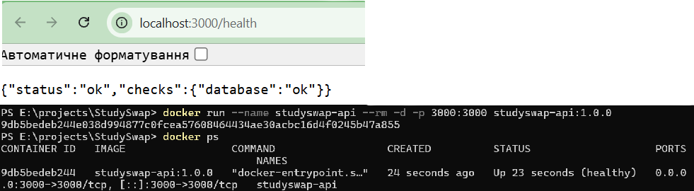

# StudySwap
Платформа для обміну навчальними матеріалами між студентами. Діліться конспектами, лекціями та шпаргалками, знаходьте потрібне за предметом і курсом

## API документація

Контракт API описано у форматі OpenAPI 3.0: [docs/api/openapi.yaml](docs/api/openapi.yaml)

Специфікацію перевірено в [Swagger Editor](https://editor.swagger.io/):


## Запуск і тести

```bash
cd backend
npm install
npm start   # API на http://localhost:3000, перевірка: GET /health → ok
npm test    # юніт-тести рівня service/
```

Вхід (`POST /auth/login`) ще не реалізовано, тому для запитів, що змінюють дані, поки використовуються тестові токени в заголовку `Authorization: Bearer <токен>`: `dev-token-anna`, `dev-token-ivan` (користувачі) і `dev-token-admin` (адмін).

## Docker

### 1. Перевірка встановлення Docker

Docker Desktop для Windows: https://docs.docker.com/desktop/setup/install/windows-install/
(якщо інсталятор просить «Virtual Machine Platform»: `wsl --install` у PowerShell від адміністратора, перезавантаження, повторне встановлення).

```bash
docker version
docker run hello-world
```

Очікуваний результат: у виводі є `Hello from Docker!`.


### 2. Контейнер бекенду

Файли: [backend/Dockerfile](backend/Dockerfile), [backend/.dockerignore](backend/.dockerignore).
Образ: Node.js 22 (`node:22-bookworm-slim`), бо `better-sqlite3` 13 вимагає Node 22+.

Команди виконуються з кореня репозиторію:

```bash
# зібрати образ
docker build -t studyswap-api:1.0.0 ./backend

# запустити контейнер: порт 3000 у контейнері -> 3000 на комп'ютері
docker run --name studyswap-api --rm -d -p 3000:3000 studyswap-api:1.0.0

# перевірити
docker ps                                # STATUS: Up ... (healthy)
curl http://localhost:3000/health        # {"status":"ok",...}
curl http://localhost:3000/materials     # JSON зі списком матеріалів
docker logs -f studyswap-api             # Server running on http://localhost:3000 (Ctrl+C — вийти з логів)

# зупинити (контейнер видалиться сам через --rm)
docker stop studyswap-api
```

Порт доступу: **http://localhost:3000**. Фронтенд (`frontend/index.html`) працює з контейнером без змін.
База SQLite створюється всередині контейнера і зникає після `docker stop`: при кожному запуску — тестові дані з `seed.js`.

Налаштування передаються змінними середовища, наприклад режим штучних збоїв для перевірки фронтенду (Практика 5):

```bash
docker run --name studyswap-api --rm -d -p 3000:3000 -e CHAOS=1 studyswap-api:1.0.0
```


