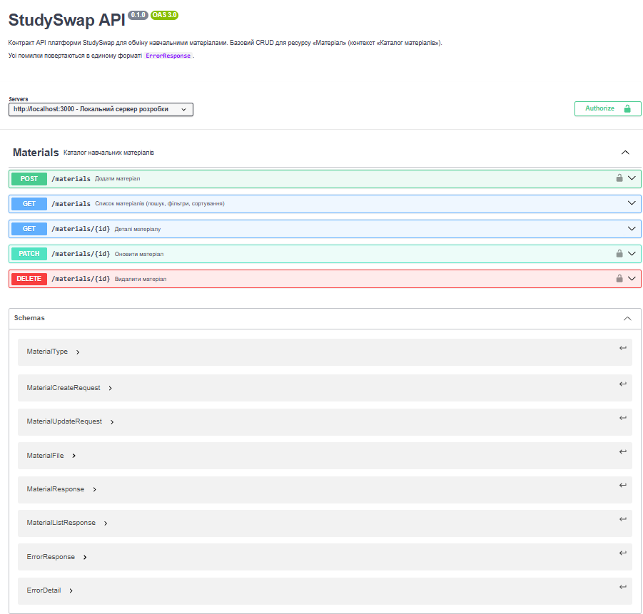
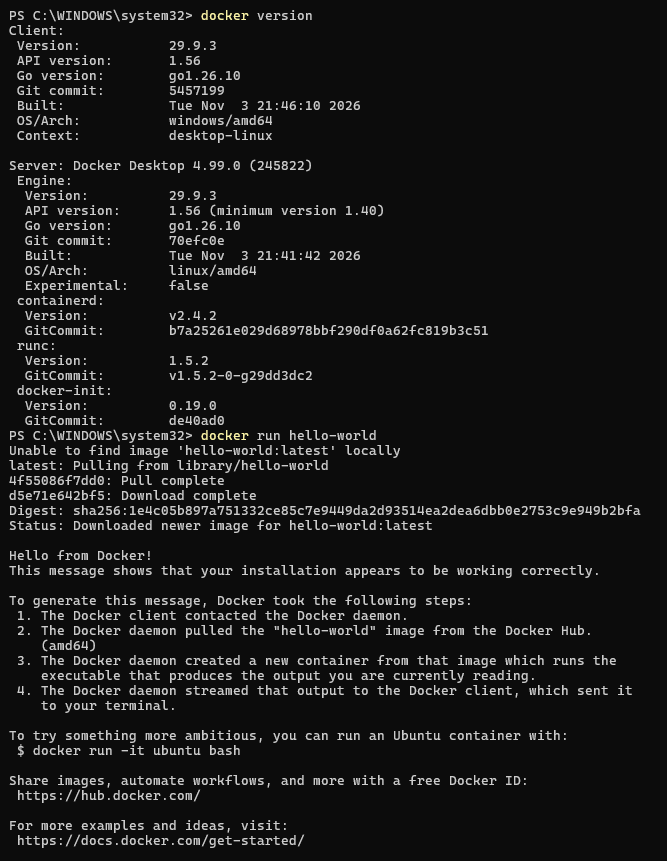

# StudySwap

[](https://github.com/JuliaVushyvana/StudySwap/actions/workflows/ci.yml)

Платформа для обміну навчальними матеріалами між студентами. Діліться конспектами, лекціями та шпаргалками, знаходьте потрібне за предметом і курсом

## API документація

Контракт API описано у форматі OpenAPI 3.0: [docs/api/openapi.yaml](docs/api/openapi.yaml)

Специфікацію перевірено в [Swagger Editor](https://editor.swagger.io/):



## Запуск і тести

```bash
cd backend
npm install
npm start   # API на http://localhost:3000, перевірка: GET /health → ok
npm test    # юніт-тести рівня service/
```

Реєстрація й вхід: `POST /auth/register`, `POST /auth/login` (логін або пошта + пароль) → JWT, `POST /auth/logout`. Запити, що змінюють дані, передають токен у заголовку `Authorization: Bearer <JWT>`. Тестові акаунти з `seed.js`: `anna_k`, `julia_v` (користувачі) і `admin1` (адмін), пароль у всіх — `studyswap123`.

Тестові матеріали мають справжні файли з `backend/seed-files/`: конспект «Нормалізація БД» (PDF), презентація «Принципи ООП» (PPTX) і «Приклади екзаменаційних питань з БД» (DOCX). Seed копіює їх у сховище (`backend/uploads/`) під час запуску.

Змінні середовища для входу: `JWT_SECRET` (ключ підпису; значення за замовчуванням лише для локальної розробки), `TOKEN_TTL_SECONDS` (строк дії токена, 3600), `BCRYPT_ROUNDS` (вартість хешування, 10).

> Якщо `backend/data.db` створено до появи входу, тестові акаунти мають заглушки замість хешів паролів: видаліть `data.db`, і seed створить їх заново.

## CI

На кожен `push` і `pull_request` GitHub Actions запускає [`.github/workflows/ci.yml`](.github/workflows/ci.yml). Він двічі викликає спільний reusable workflow [`ci-reusable.yml`](.github/workflows/ci-reusable.yml): для `backend/` і для `frontend/`.

| Job (status check) | Що робить |
|---|---|
| `backend / lint & test` | `npm ci` → `npm run lint` (ESLint) → `npm run test:coverage` (node:test + вбудований coverage) → артефакт `coverage-backend` з `lcov.info` |
| `frontend / lint & test` | `npm ci` → `npm run lint` → `npm test` (тести `lib/`) → `npm run build` (перевірка посилань і збірка в `dist/`) |

- Входи reusable workflow: `working-directory` (обов'язковий), `node-version` (типово `22`), `coverage` і `build` (типово `false`).
- Права токена мінімальні (`permissions: contents: read`). Новий запуск для тієї ж гілки скасовує попередній (`concurrency`). Кожен job має `timeout-minutes: 10`.
- [Dependabot](.github/dependabot.yml) щотижня пропонує оновлення npm-залежностей бекенду й фронтенду та версій GitHub Actions.
- Гілка `main` захищена: злиття PR можливе лише після зелених перевірок обох job-ів.

Локально ті самі перевірки:

```bash
cd backend  && npm ci && npm run lint && npm run test:coverage
cd frontend && npm ci && npm run lint && npm test && npm run build
```

Звіт покриття бекенду: Actions → потрібний запуск → Artifacts → `coverage-backend`.

## Docker

### 1. Перевірка встановлення Docker

Docker Desktop для Windows: https://docs.docker.com/desktop/setup/install/windows-install/
(якщо інсталятор просить «Virtual Machine Platform»: `wsl --install` у PowerShell від адміністратора, перезавантаження, повторне встановлення).

```bash
docker version
docker run hello-world
```

Очікуваний результат: у виводі є `Hello from Docker!`.



### 2. Контейнер бекенду

Файли: [backend/Dockerfile](backend/Dockerfile), [backend/.dockerignore](backend/.dockerignore).
Образ: Node.js 22 (`node:22-bookworm-slim`), бо `better-sqlite3` 13 вимагає Node 22+.

Команди виконуються з кореня репозиторію:

```bash
# зібрати образ
docker build -t studyswap-api:1.0.0 ./backend

# запустити контейнер: порт 3000 у контейнері -> 3000 на комп'ютері
docker run --name studyswap-api --rm -d -p 3000:3000 studyswap-api:1.0.0

# перевірити
docker ps                                # STATUS: Up ... (healthy)
curl http://localhost:3000/health        # {"status":"ok",...}
curl http://localhost:3000/materials     # JSON зі списком матеріалів
docker logs -f studyswap-api             # Server running on http://localhost:3000 (Ctrl+C — вийти з логів)

# зупинити (контейнер видалиться сам через --rm)
docker stop studyswap-api
```

Порт доступу: **http://localhost:3000**. Фронтенд (`frontend/index.html`) працює з контейнером без змін.
База SQLite створюється всередині контейнера і зникає після `docker stop`: при кожному запуску — тестові дані з `seed.js`.

Налаштування передаються змінними середовища, наприклад режим штучних збоїв для перевірки фронтенду (Практика 5):

```bash
docker run --name studyswap-api --rm -d -p 3000:3000 -e CHAOS=1 studyswap-api:1.0.0
```


### 3. Увесь застосунок через docker compose

Файл: [docker-compose.yml](docker-compose.yml). Dockerfile-и: [frontend/Dockerfile](frontend/Dockerfile) (Nginx зі статичним фронтендом), [backend/Dockerfile](backend/Dockerfile) (API).

| Сервіс | Образ | Адреса |
|---|---|---|
| `web` | `studyswap-web:1.0.0` (збирається з `./frontend`) | http://localhost:8080 |
| `api` | `studyswap-api:1.0.0` (збирається з `./backend`) | http://localhost:3000 |
| `db` | `coleifer/sqlite-web` (перегляд бази SQLite) | http://localhost:8081 |

Фронтенд у браузері звертається до API за `http://localhost:3000`, CORS на API увімкнено.
База — SQLite: файл `/app/data/studyswap.db` у томі `api-data`, тому матеріали не зникають після `docker compose down`.
SQLite — це файл, а не окремий сервер, тож замість Postgres сервіс `db` — веб-переглядач того самого файлу бази (лише читання, записує тільки API). На http://localhost:8081 видно таблиці `materials`, `users`, `stored_files`, `idempotency_keys`, `revoked_tokens`; `db` стартує, коли API вже healthy і створив таблиці.

Команди виконуються з кореня репозиторію:

```bash
# зібрати образи й підняти всі сервіси у фоні
docker compose up -d --build

# перевірити
docker compose ps                        # api: Up (healthy), web і db: Up
curl http://localhost:3000/health        # {"status":"ok","checks":{"database":"ok"}}
curl http://localhost:3000/materials     # JSON зі списком матеріалів
docker compose logs -f api               # Server running on http://localhost:3000
# фронтенд: http://localhost:8080, база: http://localhost:8081

# зупинити й видалити контейнери (томи з даними лишаються)
docker compose down

# те саме, але разом із даними (наступний запуск — знову тестові дані з seed.js)
docker compose down -v
```

Ключ підпису JWT для API задається змінною `JWT_SECRET` (наприклад, у файлі `.env` поруч із `docker-compose.yml`); без неї використовується тестовий ключ. Якщо том `api-data` створено до появи входу, тестові акаунти в ньому не мають справжніх хешів паролів — один раз виконайте `docker compose down -v`.
