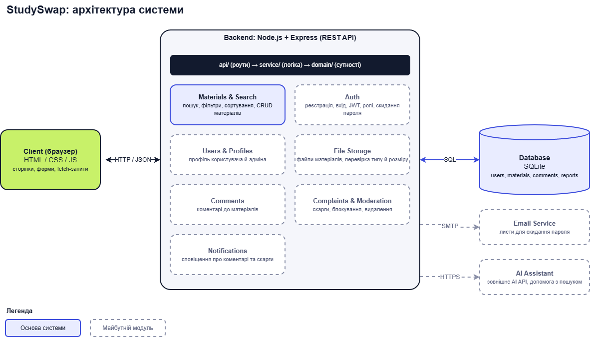
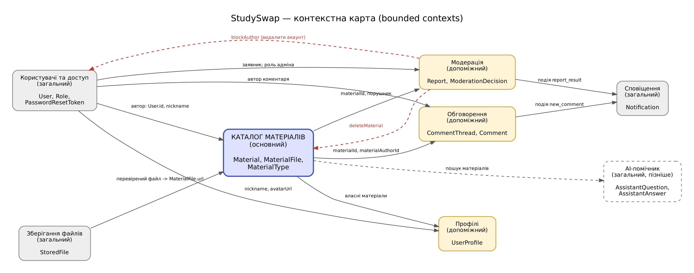
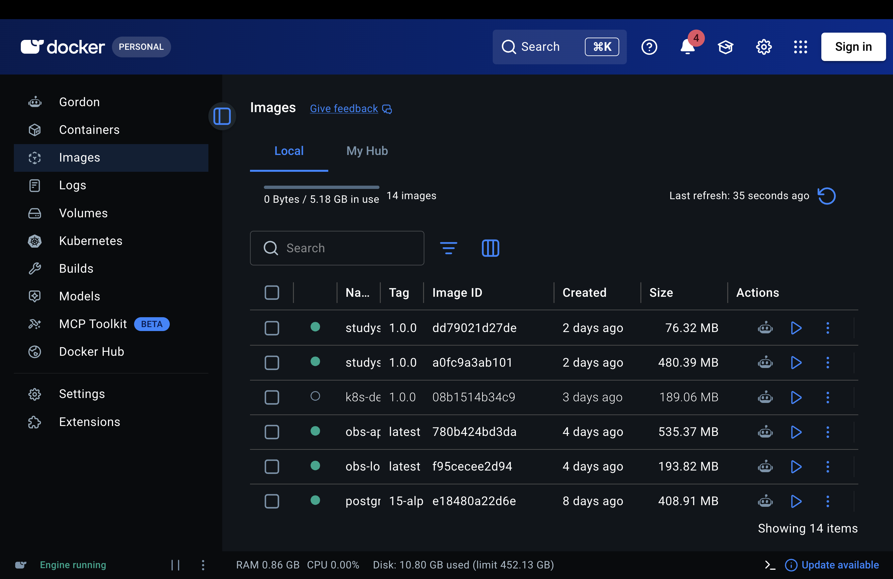
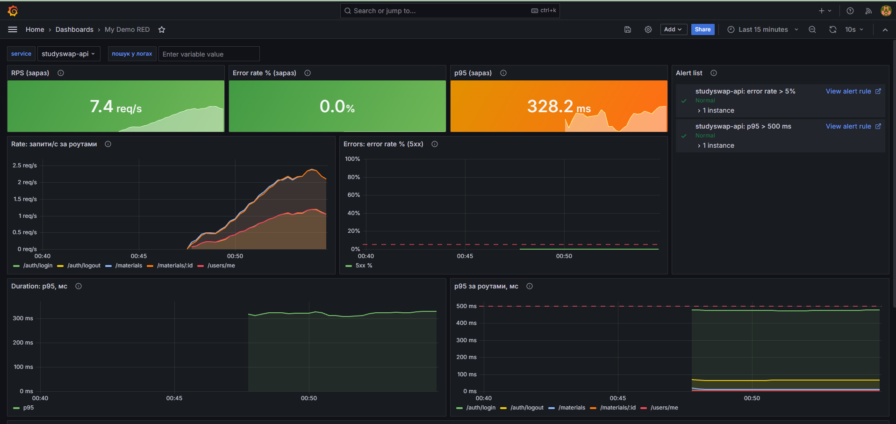
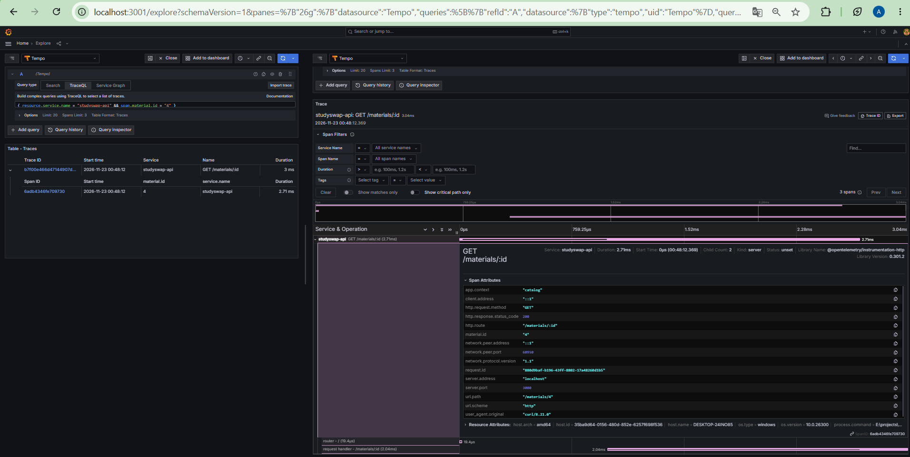
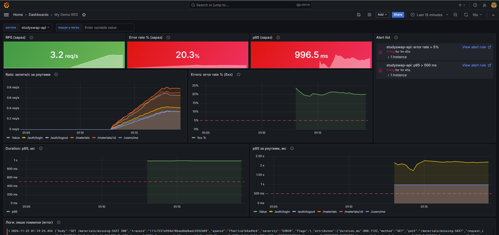
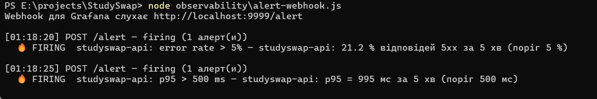
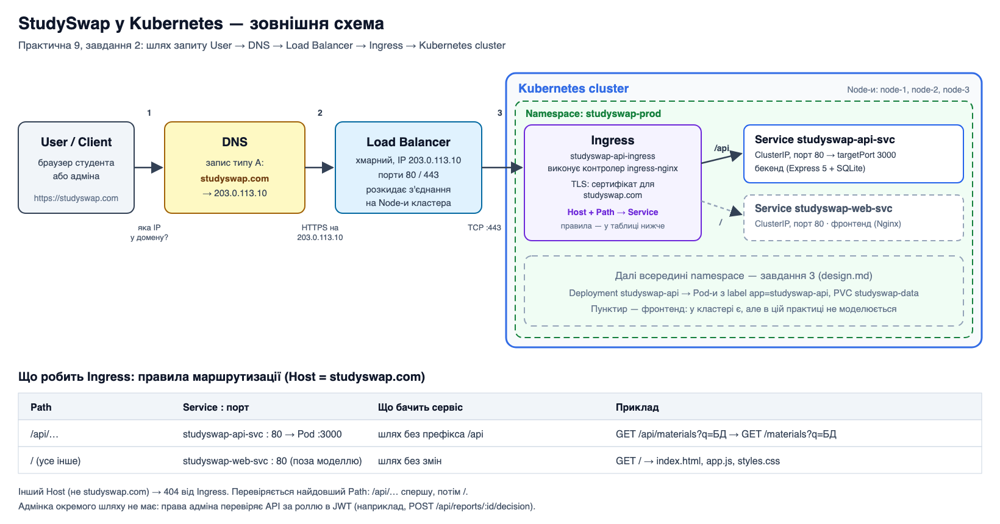
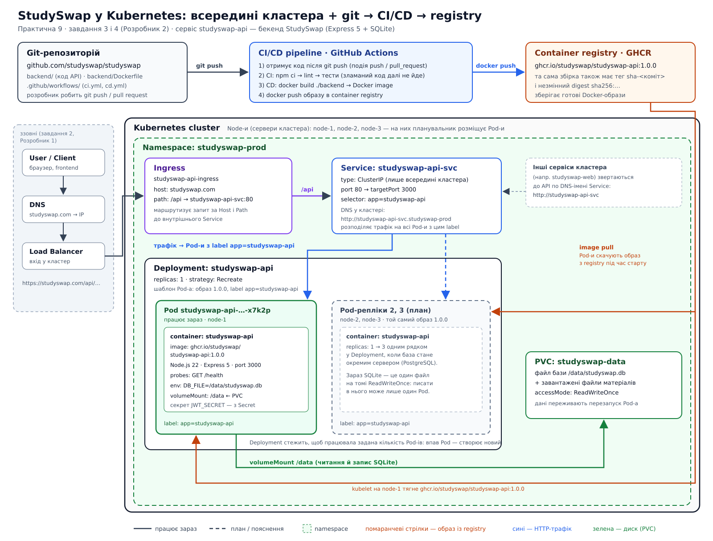

# StudySwap

[](https://github.com/JuliaVushyvana/StudySwap/actions/workflows/ci.yml)

Платформа для обміну навчальними матеріалами між студентами. Діліться конспектами, лекціями та шпаргалками, знаходьте потрібне за предметом і курсом

## Практичні роботи
Звіт по кожній практичній: завдання, що зроблено, де лежать файли й PR, як показати.

| № | Тема | Звіт |
|---|---|---|
| 1 | Клієнт → бекенд → БД, робота через fork і PR | [Практична 1](#практична-1) |
| 2 | Бізнес-документ, архітектурна діаграма, roadmap | [Практична 2](#практична-2) |
| 3 | DDD: піддомени, глосарій, контекстна карта, моделі | [Практична 3](#практична-3) |
| 4 | Модульний моноліт, OpenAPI, CRUD, ADR | [Практична 4](#практична-4) |
| 5 | Обробка збоїв: ідемпотентність, ретраї, degraded mode | [Практична 5](#практична-5) |
| 6 | Docker і docker compose | [Практична 6](#практична-6) |
| 7 | CI/CD на GitHub Actions | [Практична 7](#практична-7) |
| 8 | Observability: Grafana, Loki, Tempo, OpenTelemetry | [Практична 8](#практична-8) |
| 9 | Теоретична схема Kubernetes | [Практична 9](#практична-9) |
| 10 | Kubernetes на практиці (Minikube) | [Практична 10](#практична-10) |


### Практична 1

**Базовий клієнт → бекенд → БД**

**Завдання:** обрати тему проєкту, підняти сервер з `GET /items`, базу з таблицею `items (id, name)`, HTML-сторінку з кнопкою «Load items» і налагодити роботу через fork → pull request.

**Що зроблено:**

- **Тема:** StudySwap — платформа для обміну навчальними матеріалами між студентами.
- **БД:** SQLite (`better-sqlite3`), таблиця `items (id, name)` з тестовими рядками — `backend/db.js`.
- **Бекенд:** Node.js + Express, `GET /items` повертає рядки з БД — `backend/server.js`.
- **Клієнт:** `frontend/index.html` — кнопка «Load items» викликає API й виводить список.
- **Git:** лідер створила репозиторій зі структурою `backend/`, `frontend/`, `docs/`; учасниця працює у fork [lyutyanytsyaa/StudySwap](https://github.com/lyutyanytsyaa/StudySwap) і власних гілках, зміни приходять через PR.

**Де дивитись:** пізніше `items` замінили на `materials`, тому код практики — у стані репозиторію після PR #3: [дерево коміту `af7a98f`](https://github.com/JuliaVushyvana/StudySwap/tree/af7a98f).

| PR | Що додано |
|---|---|
| [#1](https://github.com/JuliaVushyvana/StudySwap/pull/1) | SQLite (`db.js`) і `package.json` |
| [#2](https://github.com/JuliaVushyvana/StudySwap/pull/2) | Express-сервер з `GET /items` |
| [#3](https://github.com/JuliaVushyvana/StudySwap/pull/3) | сторінка з кнопкою «Load items» |

**Як показати:**

```bash
git checkout af7a98f
cd backend && npm install && npm start   # http://localhost:3000/items → JSON зі списком
# відкрити frontend/index.html → «Load items» → список із БД
git checkout main
```

**Відкрити:** [localhost:3000/items](http://localhost:3000/items) — JSON зі списком.

Ланцюжок: браузер → `fetch('/items')` → Express → SQL `SELECT id, name FROM items` → SQLite → JSON → список на сторінці.

[↑ До списку практичних](#практичні-роботи)


### Практична 2

**Бізнес-документ і архітектурна діаграма**

**Завдання:** формалізувати ідею проєкту в `docs/`: бізнес-документ, архітектурна діаграма з майбутніми модулями, roadmap на найближчі тижні.

**Що зроблено:**

| Файл | Зміст |
|---|---|
| [business_doc.md](docs/business_doc.md) | опис системи, ролі (гість, користувач, адмін) і матриця доступу, 5 сценаріїв, функціональні вимоги «Як [роль] хочу…» з AC Given / When / Then і кодами відповідей, нефункціональні вимоги (p95 `GET /materials` ≤ 500 мс, до 100 одночасних користувачів), обмеження |
|
| [architecture.md](docs/architecture.md) | пояснення кожного блока діаграми, умовні позначення, приклад шляху запиту |
| [roadmap.md](docs/roadmap.md) | план тижнів 1–8 з DoD для кожного тижня |


 |

**Як показати:**

1. [business_doc.md](docs/business_doc.md): ролі → матриця доступу → сценарії → вимоги → обмеження.
2. Діаграма: шлях запиту браузер → REST API → SQLite; пунктиром — модулі, які з'являться пізніше.
3. [roadmap.md](docs/roadmap.md): що планували на кожен тиждень і що означає «готово» (DoD).

[↑ До списку практичних](#практичні-роботи)


### Практична 3

**DDD: моделювання домену та межі контекстів**

**Завдання:** поділити проєкт на піддомени, скласти глосарій (Ubiquitous Language), намалювати контекстну карту й створити прототипи сутностей у коді.

**Що зроблено:**

- **8 bounded contexts:** `access` (користувачі й доступ), `profiles`, `catalog` (каталог матеріалів), `storage` (файли), `discussion` (коментарі), `moderation` (скарги), `notifications`, `assistant` (AI-помічник).
- **Сутності й атрибути** для кожного піддомену та зв'язки між ними — [domain/entities.md](docs/domain/entities.md).
- **Глосарій** із 10 термінів (Матеріал, Каталог, Скарга, Блокування…) і таблицею, як «Користувач» називається в різних контекстах: Автор матеріалу, Заявник, Порушник, Отримувач — [domain/glossary.md](docs/domain/glossary.md).
- **Контекстна карта** — хто кому надає дані:



- **Прототипи в коді** — [`backend/domain/`](backend/domain/), по папці на контекст: `User` (`block()`), `Material`, `CommentThread`, `Report` (`resolve()`, `reject()`), `Notification`, `UserProfile`, `StoredFile`, `Assistant`. Сутності без Express і SQL, лише поля та інваріанти.

**Де дивитись:** PR [#12](https://github.com/JuliaVushyvana/StudySwap/pull/12) — контекстна карта й прототипи моделей; [`backend/domain/demo.js`](backend/domain/demo.js) — сценарій, що використовує сутності.

**Як показати:**

```bash
cd backend && node domain/demo.js   # сутності в дії без БД і HTTP: публікація, пошук, коментар, скарга, блокування
```

1. Контекстна карта → назвати 8 контекстів і стрілки між ними.
2. Глосарій, розділ 2 → чому один акаунт має різні назви в різних контекстах.
3. `backend/domain/moderation/Report.js` → інваріант «розглянуту скаргу не можна розглянути вдруге».

[↑ До списку практичних](#практичні-роботи)


### Практична 4

**Стиль архітектури, контракт OpenAPI і CRUD**

**Завдання:** обрати модульний моноліт або мікросервіси й зафіксувати це в ADR, описати CRUD в `openapi.yaml` і перевірити в Swagger Editor, реалізувати CRUD за контрактом, `GET /health` і юніт-тести рівня `service/`.

**Що зроблено:**

- **Вибір стилю — модульний моноліт:** один Express-процес і одна SQLite, код поділено на модулі за контекстами з Практики 3 — [ADR-0001](docs/adr/0001-architecture-style.md).
- **Шари `api/` → `service/` → `domain/`:** роут лише приймає запит і віддає відповідь, логіка й SQL — у `service/`, сутності — у `domain/`; `api/` не ходить у БД напряму — [ADR-0002](docs/adr/0002-layered-architecture.md).
- **Стиль REST і єдиний `ErrorResponse`** `{ error, code, details, requestId }`, політика кодів (400, 401, 403, 404, 409…) — [ADR-0003](docs/adr/0003-api-style-and-error-model.md).
- **Контракт:** [api/openapi.yaml](docs/api/openapi.yaml) — `POST /materials` (201), `GET /materials` (200, пошук `q`, фільтри, пагінація), `GET /materials/{id}` (200, 404), `PATCH /materials/{id}` (200, 400, 404), `DELETE /materials/{id}` (204, 404), DTO і `GET /health`. Пізніше контракт доповнено auth, коментарями, скаргами, файлами.
- **Код:** [`api/catalog/materialsRouter.js`](backend/api/catalog/materialsRouter.js) → [`service/catalog/materialService.js`](backend/service/catalog/materialService.js) + [`materialDto.js`](backend/service/catalog/materialDto.js) → [`domain/catalog/Material.js`](backend/domain/catalog/Material.js).
- **Тести:** [`backend/test/catalog/materialService.test.js`](backend/test/catalog/materialService.test.js) 

Контракт: вставити `docs/api/openapi.yaml` на https://editor.swagger.io/ — специфікація без помилок.


CRUD матеріалів у шарах `api/service/domain`, `GET /health`, тести |
**Як показати:**

```bash
cd backend && npm install && npm start
curl http://localhost:3000/health
curl "http://localhost:3000/materials?q=БД&page=1"
curl -i http://localhost:3000/materials/999          # 404 у форматі ErrorResponse
npm test                                            # юніт-тести service/
```

**Відкрити:** [/health](http://localhost:3000/health) · [/materials](http://localhost:3000/materials) · [пошук «БД»](http://localhost:3000/materials?q=%D0%91%D0%94&page=1) · [/materials/999 → 404](http://localhost:3000/materials/999)

[↑ До списку практичних](#практичні-роботи)


### Практична 5

**Обробка збоїв: ідемпотентність, ретраї, таймаути, degraded mode**

**Завдання:** зробити POST ідемпотентним через `Idempotency-Key`, додати `X-Request-Id`, rate-limit з `Retry-After`, клієнтські ретраї з backoff і джитером, таймаут через `AbortController`, єдиний формат помилки й degraded mode на фронті.

Рішення й обґрунтування — [ADR-0004](docs/adr/0004-error-handling-and-resilience.md).

**Бекенд** ([`backend/api/middleware/`](backend/api/middleware/)):

| Механізм | Де | Як працює |
|---|---|---|
| `X-Request-Id` | `requestId.js` | бере з запиту або генерує UUID, віддає в кожній відповіді й у тілі помилки |
| Ідемпотентність | `service/idempotency/` | `POST /materials` без `Idempotency-Key` → 400; повтор з тим самим ключем повертає той самий матеріал, без дубля (таблиця `idempotency_keys`) |
| Rate-limit | `rateLimit.js` | понад 50 запитів за 10 с → `429` + `Retry-After` |
| Таймаут сервера | `timeout.js` | запит довший за 5 с → `503` + `Retry-After` |
| Єдина помилка | `errorHandler.js` | усі помилки → `{ error, code, details, requestId }` |
| Degraded каталог | `materialService.js` | БД недоступна → `GET /materials` віддає останню копію каталогу з `degraded: true` |
| Штучні збої | `faultInjection.js` | лише при `CHAOS=1`: затримки, 500 і 503 для перевірки клієнта |

Ліміти налаштовуються env-змінними в [`backend/config.js`](backend/config.js).

**Фронтенд** ([`frontend/lib/`](frontend/lib/)):

- `http.js` — `fetchWithResilience`: таймаут 3 с через `AbortController`, 2 ретраї на 5xx і мережеві збої з експоненційним backoff (300 → 600 мс) і джитером, на 429 чекає `Retry-After`.
- `idempotency.js` — ключ за SHA-256 від payload у `localStorage`: подвійний клік чи повтор шле той самий ключ.
- `degraded.js` — після 3 збоїв поспіль банер «перевантажено» і вимкнені кнопки; через 10 с перевіряє `/health` і виходить із режиму.
- Тести: [`frontend/test/`](frontend/test/), [`backend/test/idempotency/`](backend/test/idempotency/), [`backend/test/api/resilienceMiddleware.test.js`](backend/test/api/resilienceMiddleware.test.js).

| PR | Що додано |
|---|---|
| [#15](https://github.com/JuliaVushyvana/StudySwap/pull/15) | resilient fetch, ідемпотентність, degraded mode на фронті |
| [#16](https://github.com/JuliaVushyvana/StudySwap/pull/16) | серверна частина: middleware, `idempotency_keys`, degraded каталог |

**Як показати:**

```bash
cd backend && npm start

# X-Request-Id і єдиний формат помилки
curl -i -H "X-Request-Id: demo-1" localhost:3000/materials/999
# → заголовок X-Request-Id: demo-1, тіло {"error":"NotFound","code":"MATERIAL_NOT_FOUND","details":null,"requestId":"demo-1"}

# rate-limit: 60 запитів за 10 с → після 50-го приходить 429 і Retry-After
for i in $(seq 60); do curl -s -o /dev/null -w "%{http_code} " localhost:3000/materials; done

# ідемпотентність: тест «повтор із тим самим Idempotency-Key → той самий матеріал без дубліката»
npm test
```

**Відкрити:** [/materials/999](http://localhost:3000/materials/999) — тіло помилки з `requestId` · [/health](http://localhost:3000/health)

Фронтенд: перезапустити сервер зі штучними збоями `CHAOS=1 npm start` і відкрити `frontend/index.html`, `add.html`:

- DevTools → Network: видно ретраї з паузами й заголовки `Idempotency-Key`, `X-Request-Id`;
- подвійний клік «Опублікувати» → один матеріал у каталозі;
- після кількох збоїв поспіль — банер degraded mode і вимкнені кнопки, через 10 с сторінка відновлюється.

[↑ До списку практичних](#практичні-роботи)


### Практична 6

**Docker: hello-world, контейнеризація, docker compose**

**Завдання:** встановити Docker і запустити `hello-world` (60), додати `Dockerfile` і `.dockerignore` для свого сервісу (75–89), підняти frontend + api + db однією командою через `docker compose` (90–100).

| Рівень | Результат | Файли |
|---|---|---|
| 60 | Docker Desktop, `docker run hello-world` → «Hello from Docker!» | [скрін](docs/docker/hello-world.png) |
| 75–89 | образ бекенду `studyswap-api:1.0.0` на `node:22-bookworm-slim` (Node 22 — вимога `better-sqlite3` 13), healthcheck на `/health` | [backend/Dockerfile](backend/Dockerfile), [backend/.dockerignore](backend/.dockerignore) |
| 90–100 | `docker compose`: `web` (Nginx зі статичним фронтендом, :8080), `api` (:3000), `db` (:8081) | [docker-compose.yml](docker-compose.yml), [frontend/Dockerfile](frontend/Dockerfile) |

**Чому `db` — не Postgres.** Проєкт лишається на SQLite: база — файл `/app/data/studyswap.db` у томі `api-data`, тож дані переживають `docker compose down`. Сервіс `db` — веб-переглядач `sqlite-web` того самого файлу (лише читання); стартує, коли `api` вже healthy і створив таблиці.

**Скріни:**

`docker run hello-world` — Docker встановлено й працює:


Docker Desktop → Images: зібрані образи `studyswap-web:1.0.0` (76 МБ) і `studyswap-api:1.0.0` (480 МБ), внизу — «Engine running»:



Контейнер бекенду запущений:


| PR | Що додано |
|---|---|
| [#17](https://github.com/JuliaVushyvana/StudySwap/pull/17) | Dockerfile і `.dockerignore` бекенду |
| [#19](https://github.com/JuliaVushyvana/StudySwap/pull/19) | Dockerfile фронтенду, `docker-compose.yml` |

**Як показати:**

```bash
docker version && docker run hello-world

# один контейнер
docker build -t studyswap-api:1.0.0 ./backend
docker run --name studyswap-api --rm -d -p 3000:3000 studyswap-api:1.0.0
curl http://localhost:3000/health
docker stop studyswap-api

# увесь застосунок
docker compose up -d --build
docker compose ps                  # api: Up (healthy), web і db: Up
curl http://localhost:3000/health  # {"status":"ok","checks":{"database":"ok"}}
# http://localhost:8080 — сайт, http://localhost:8081 — таблиці бази
docker compose down
```

**Відкрити:** [сайт :8080](http://localhost:8080) · [API /health :3000](http://localhost:3000/health) · [API /materials](http://localhost:3000/materials) · [база :8081](http://localhost:8081)

[↑ До списку практичних](#практичні-роботи)


### Практична 7

**CI/CD **

**Завдання:** налаштувати, щоб GitHub сам перевіряв код (CI) і сам збирав та публікував Docker-образи застосунку (CD).

**Простими словами:**

- **CI (Continuous Integration)** — автоматична перевірка. На кожен `push` і кожен pull request GitHub запускає лінтер і тести. Якщо щось червоне, PR у `main` злити не можна.
- **CD (Continuous Delivery)** — автоматична доставка. Після злиття в `main` GitHub збирає Docker-образи бекенду й фронтенду і кладе їх у GitHub Container Registry (GHCR), звідки їх можна завантажити й запустити.

```
push / PR ──► CI: lint + тести (backend, frontend) ──► ✅ можна зливати в main
злиття в main ──► CD: CI ще раз ──► збірка образів api і web ──► публікація в GHCR ──► перевірка на вразливості (Trivy)
```

**Що де лежить:**

| Файл | Що робить |
|---|---|
| [ci.yml](.github/workflows/ci.yml) | CI: запускається на кожен push і PR |
| [ci-reusable.yml](.github/workflows/ci-reusable.yml) | спільні кроки перевірки (`npm ci` → лінт → тести), їх використовують і CI, і CD |
| [cd.yml](.github/workflows/cd.yml) | CD: збирає й публікує образи |
| [dependabot.yml](.github/dependabot.yml) | бот щотижня пропонує PR з оновленнями бібліотек |

**Результат — два опубліковані образи:**

| Сервіс | Образ |
|---|---|
| бекенд | [studyswap-api](https://github.com/JuliaVushyvana/StudySwap/pkgs/container/studyswap-api) |
| фронтенд | [studyswap-web](https://github.com/JuliaVushyvana/StudySwap/pkgs/container/studyswap-web) |

**Додаткові бали (style points) — що це й навіщо:**

| Що зроблено | Навіщо |
|---|---|
| теги образів `latest` і `sha-<коміт>` (`v1.0.0` на реліз) | видно, з якого коміту зібрано образ |
| reusable workflow | кроки перевірки описано один раз, а не двічі |
| Dependabot | бібліотеки не застарівають |
| мінімальні права (`permissions`) | право публікувати образи має лише один крок |
| `concurrency` | новий запуск скасовує старий, щоб не гаяти час |
| Trivy | звіт про вразливості в образах |
| Job Summary | підсумок запуску (теги, покриття тестами) прямо на сторінці Actions |
| чернетка релізу на тег `v*` | реліз-ноти пишуться автоматично |

**Як показати:**

1. [Запуски CI](https://github.com/JuliaVushyvana/StudySwap/actions/workflows/ci.yml) → будь-який запуск: два зелені job-и `backend` і `frontend`.
2. Будь-який PR → вкладка **Checks**: ті самі перевірки, без них PR не злити.
3. [Запуски CD](https://github.com/JuliaVushyvana/StudySwap/actions/workflows/cd.yml) → останній: схема кроків і Summary внизу.
4. [Образ studyswap-api](https://github.com/JuliaVushyvana/StudySwap/pkgs/container/studyswap-api): опубліковані версії з тегами.

PR: [#24](https://github.com/JuliaVushyvana/StudySwap/pull/24) (CI), [#29](https://github.com/JuliaVushyvana/StudySwap/pull/29) (CD), [#28](https://github.com/JuliaVushyvana/StudySwap/pull/28) (приклад PR від Dependabot).

[↑ До списку практичних](#практичні-роботи)


### Практична 8

**Observability: Grafana, Loki, Tempo, OpenTelemetry**

**Завдання:** запустити стенд [observability-demo](https://github.com/vivalafit/observability-demo) і прочитати RED-метрики, логи й трейси (60), зібрати свій дашборд (75), підключити свій сервіс до OTEL-колектора (90), налаштувати алерти (95–100).

**Повний звіт:** [practice8/report.md](docs/practice8/report.md) — PromQL, LogQL, TraceQL, змінні оточення, runbook-и.

| Рівень | Результат |
|---|---|
| 60 | стенд піднято; скріни RED-дашборду, трейсу в Tempo й логів у Loki для `demo-app` |
| 75 | дашборд **My Demo RED** зі змінною `$service`: RPS, error rate %, p95, p95 за роутами, логи помилок — [my-demo-red-dashboard.json](docs/my-demo-red-dashboard.json) |
| 90 | `studyswap-api` надсилає трейси, метрики й логи по OTLP (`backend/tracing.js`, `npm run start:otel`); атрибути спанів `http.route`, `user.id`, `material.id`, `app.context`, `request.id` |
| 95–100 | два алерти (error rate > 5 %, p95 > 500 мс за 5 хв), webhook contact point, Alert list на дашборді, runbook для кожного — [alerts.yaml](docs/alerts.yaml) |

| Метрики (дашборд на `studyswap-api`) | Трейс з `material.id` |
|---|---|
|  |  |

| Алерти Firing | Сповіщення у webhook |
|---|---|
|  |  |

- Код телеметрії: [backend/tracing.js](backend/tracing.js), [backend/logger.js](backend/logger.js), [api/middleware/telemetry.js](backend/api/middleware/telemetry.js).
- Конфіги стенду: [observability/](observability/) — колектор, Prometheus, приймач webhook.
- Навантаження: [scripts/load.sh](scripts/load.sh).

| PR | Що додано |
|---|---|
| [#30](https://github.com/JuliaVushyvana/StudySwap/pull/30) | OpenTelemetry для `studyswap-api`: трейси, метрики, логи |
| [#35](https://github.com/JuliaVushyvana/StudySwap/pull/35) | дашборд My Demo RED, алерти, webhook, звіт |

**Як показати:**

```bash
# 1. стенд (поруч із цим репо) з нашими конфігами колектора й Prometheus
cp observability/otel-collector-config.yaml observability/prometheus.yml ../observability-demo/
cd ../observability-demo && docker compose up -d --build && docker compose stop loadgen app

# 2. API з телеметрією і навантаження
cd ../StudySwap/backend && cp .env.example .env && npm install && npm run start:otel
../scripts/load.sh

# 3. збої для алертів: FAULT_ERROR_RATE=0.2 або FAULT_DELAY_MS=800 у backend/.env, перезапуск API,
#    DURATION=600 ../scripts/load.sh → через ~5 хв алерти Firing
```

**Відкрити:** [Grafana :3001](http://localhost:3001) (admin / admin) · [Дашборди](http://localhost:3001/dashboards) · [Explore](http://localhost:3001/explore) · [Alerting](http://localhost:3001/alerting/list) · [Prometheus :9090](http://localhost:9090) · [API /health](http://localhost:3000/health)

У Grafana: дашборд My Demo RED → `$service = studyswap-api`; Explore → Tempo → TraceQL `{resource.service.name="studyswap-api" && span.material.id="5"}`; Explore → Loki → `{service_name="studyswap-api", level="ERROR"}`.

Три сигнали: **метрики** кажуть, *що* погано, **трейси** — *де саме*, **логи** — *чому*.

[↑ До списку практичних](#практичні-роботи)


### Практична 9

**Теоретична схема Kubernetes-додатку**

**Завдання:** «паперова» практика — намалювати шлях запиту від користувача до Pod-а, сутності кластера (Namespace, Deployment, Service, Pod, Ingress) і місце git → CI/CD → registry, описати дизайн у 3–5 реченнях.

**Звіт:** [practice9/report.md](docs/practice9/report.md) — опис сервісу й зовнішня схема, правила Ingress; [practice9/design.md](docs/practice9/design.md) — схема всередині кластера, git → CI/CD → registry, опис дизайну.

| Зовнішня: від користувача до кластера | Всередині кластера і CI/CD |
|---|---|
|  |  |

| Елемент | Значення |
|---|---|
| Сервіс | `studyswap-api` — бекенд StudySwap (Express 5 + SQLite) |
| Домен | `studyswap.com`: `/api/…` → бекенд (префікс відрізається), решта → фронтенд; один домен — CORS не потрібен |
| Namespace | `studyswap-prod` |
| Service | `studyswap-api-svc`, ClusterIP, 80 → 3000 |
| Deployment | `studyswap-api`, **1 репліка**, `strategy: Recreate`, образ `ghcr.io/studyswap/studyswap-api:1.0.0` |
| Сховище | PVC `studyswap-data` (ReadWriteOnce), файл SQLite `/data/studyswap.db` |
| git → CI/CD → registry | `git push` → GitHub Actions (тести, збірка образу) → GHCR → kubelet скачує образ під час старту Pod-а |

**Чому 1 Pod:** SQLite — один файл на томі ReadWriteOnce, писати в нього може лише один процес. Тому `replicas: 1` і `Recreate` (старий Pod зупиняється до старту нового). Репліки 2–3 на схемі пунктиром — план на випадок переходу на окремий сервер БД.

**Як показати:** провести по схемі повний шлях запиту **Client → DNS (`studyswap.com` → `203.0.113.10`) → Load Balancer → Ingress (TLS, Host + Path) → Service → Pod** і окремо ланцюжок **git → CI/CD → registry → Pod**.

PR: [#39](https://github.com/JuliaVushyvana/StudySwap/pull/39), [#44](https://github.com/JuliaVushyvana/StudySwap/pull/44), [#45](https://github.com/JuliaVushyvana/StudySwap/pull/45).

[↑ До списку практичних](#практичні-роботи)


### Практична 10

**Kubernetes, практична частина (Minikube)**

**Завдання:** розгорнути сервіс у Minikube через Deployment + Service і port-forward (60), ConfigMap і Secret, `describe` і `logs` (75), Ingress з доменом, debug-флоу й самовідновлення Pod-ів (90), міграція власного сервісу (100).

Лабораторну виконано на бекенді StudySwap замість тестового [vivalafit/k8s-demo](https://github.com/vivalafit/k8s-demo). Спершу — у fork-у [JuliaVushyvana/k8s-demo](https://github.com/JuliaVushyvana/k8s-demo); маніфести StudySwap виросли з його рівня 100.

**Звіт:** [practice10/REPORT.md](docs/practice10/REPORT.md) — кроки рівнів 60–100, виводи команд, відповіді на контрольні запитання. **Маніфести:** [`k8s/`](k8s/) — Namespace, ConfigMap, PVC, Deployment, Service, Ingress.

**Що з'ясували:**

- **SQLite задає форму Deployment-а:** одна репліка, `strategy: Recreate` і PVC `ReadWriteOnce` — інакше два процеси писали б в один файл бази.
- **Env з ConfigMap читаються лише під час старту контейнера.** Після `kubectl apply` Pod бачив старий `RATE_LIMIT_MAX=50`, після `kubectl rollout restart` — новий `3`, і четвертий запит отримав `429`.
- **~15 с без API на кожному rollout:** `Recreate` спершу зупиняє старий Pod, а `server.js` не обробляє SIGTERM, тож kubelet чекає `terminationGracePeriodSeconds` (10 с) і вбиває процес.
- **`kubectl delete pod` обходить `Recreate`:** ReplicaSet створює заміну одразу, тож ~10 с два процеси мають відкритий один файл SQLite.
- **Дані переживають заміну Pod-а:** коментар, створений до `kubectl delete pod`, був на місці після самовідновлення — база лежить на PVC.

**Шлях запиту:**

```
port-forward:  localhost:8080 → kubectl → API-сервер → kubelet → Pod :3000
Ingress:       studyswap.local → /etc/hosts 127.0.0.1 → minikube tunnel → ingress-nginx
               → Ingress studyswap-ingress (Host studyswap.local, path /) → Service studyswap-api:80 → Pod :3000
```

PR: [#43](https://github.com/JuliaVushyvana/StudySwap/pull/43), [#47](https://github.com/JuliaVushyvana/StudySwap/pull/47).

**Як показати:**

```bash
minikube start --driver=docker --memory=3072
minikube addons enable ingress
docker build -t studyswap-api:1.0.0 ./backend
minikube image load studyswap-api:1.0.0

kubectl apply -f k8s/namespace.yaml
kubectl create secret generic studyswap-secret -n studyswap --from-literal=JWT_SECRET="$(openssl rand -hex 32)"
kubectl apply -f k8s/
kubectl rollout status deployment/studyswap-api -n studyswap

kubectl port-forward svc/studyswap-api 8080:80 -n studyswap   # http://localhost:8080/health
kubectl delete pod -l app=studyswap-api -n studyswap && kubectl get pods -n studyswap -w   # самовідновлення
```

**Відкрити:** через port-forward — [localhost:8080/health](http://localhost:8080/health) · [localhost:8080/materials](http://localhost:8080/materials); через Ingress (`minikube tunnel` і запис `127.0.0.1 studyswap.local` у `/etc/hosts`) — [studyswap.local/health](http://studyswap.local/health) · [studyswap.local/materials](http://studyswap.local/materials)

[↑ До списку практичних](#практичні-роботи)

## Запуск і тести

```bash
cd backend
npm install
npm start   # API на http://localhost:3000, перевірка: GET /health → ok
npm test    # юніт-тести рівня service/
```

Реєстрація й вхід: `POST /auth/register`, `POST /auth/login` (логін або пошта + пароль) → JWT, `POST /auth/logout`. Запити, що змінюють дані, передають токен у заголовку `Authorization: Bearer <JWT>`. Тестові акаунти з `seed.js`: `anna_k`, `julia_v` (користувачі) і `admin1` (адмін), пароль у всіх — `studyswap123`.

Тестові матеріали мають справжні файли з `backend/seed-files/`: конспект «Нормалізація БД» (PDF), презентація «Принципи ООП» (PPTX) і «Приклади екзаменаційних питань з БД» (DOCX). Seed копіює їх у сховище (`backend/uploads/`) під час запуску.

Змінні середовища для входу: `JWT_SECRET` (ключ підпису; значення за замовчуванням лише для локальної розробки), `TOKEN_TTL_SECONDS` (строк дії токена, 3600), `BCRYPT_ROUNDS` (вартість хешування, 10).

> Якщо `backend/data.db` створено до появи входу, тестові акаунти мають заглушки замість хешів паролів: видаліть `data.db`, і seed створить їх заново.
