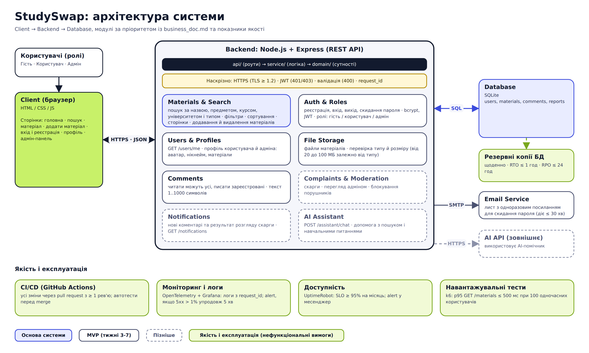

# Архітектура StudySwap




## Загальна схема

```
Користувачі (Гість · Користувач · Адмін)
        │
Client (браузер)  <-- HTTPS · JSON -->  Backend (Express REST API)  <-- SQL -->  Database (SQLite)
                                               │                                      │
                                               ├── SMTP --> Email Service       щоденна резервна копія
                                               └── HTTPS --> AI API (пізніше)
```

## Умовні позначення

| Вигляд блока | Значення |
|---|---|
| Суцільна індиго-рамка | Основа системи: пошук і каталог матеріалів, база даних |
| Суцільна сіра рамка | Модулі MVP (тижні 3-7) |
| Пунктирна рамка | Пізніший етап: скарги й модерація, сповіщення, AI-помічник |
| Світло-зелена заливка | Якість і експлуатація (нефункціональні вимоги) |

## Що означає кожен блок

| Блок | Що робить |
|---|---|
| **Користувачі (ролі)** | Гість (перегляд і пошук), Користувач (додає матеріали, коментує, скаржиться), Адмін (модерація). Права визначає матриця доступу з `business_doc.md`. |
| **Client (браузер)** | Сторінки на HTML/CSS/JS: головна, пошук, матеріал, додавання матеріалу, вхід і реєстрація, профіль, адмін-панель. Надсилає запити до API. |
| **Backend (Express REST API)** | Сервер на Node.js. Приймає запити, перевіряє права, виконує логіку, повертає JSON. Шари: `api/` (роути), `service/` (логіка), `domain/` (сутності). Наскрізно: HTTPS, перевірка JWT, валідація, `request_id`. |
| **Database (SQLite)** | Зберігає користувачів, матеріали, коментарі та скарги. |
| **Materials & Search** | Пошук за назвою, предметом, курсом, університетом і типом; фільтри, сортування, пагінація; додавання й видалення матеріалів. |
| **Auth & Roles** | Реєстрація, вхід, вихід, скидання пароля; bcrypt, JWT; ролі гість, користувач, адмін. |
| **Users & Profiles** | Профіль користувача й адміна: аватар, нікнейм, список матеріалів (`GET /users/me`). |
| **File Storage** | Файли матеріалів; перевірка типу й розміру. |
| **Comments** | Читання коментарів (усі) і додавання (зареєстровані). |
| **Complaints & Moderation** | Скарги, їх перегляд адміном, блокування порушників (пізніше). |
| **Notifications** | Сповіщення про нові коментарі та результат розгляду скарги (пізніше). |
| **AI Assistant** | Помічник із пошуку матеріалів і навчальних питань, використовує зовнішнє AI API (пізніше). |
| **Email Service** | Лист з одноразовим посиланням для скидання пароля (діє до 30 хв). |
| **AI API (зовнішнє)** | Зовнішній сервіс, до якого звертається AI-помічник. |
| **Резервні копії БД** | Щоденна копія; відновлення за ≤ 1 год, втрата даних ≤ 24 год. |
| **CI/CD (GitHub Actions)** | Автоматичні тести; усі зміни через pull request з рев'ю. |
| **Моніторинг і логи** | OpenTelemetry + Grafana, логи з `request_id`; alert, якщо 5xx > 1% упродовж 5 хв. |
| **Доступність** | UptimeRobot, ціль не менше 95% на місяць. |
| **Навантажувальні тести** | k6: p95 `GET /materials` ≤ 500 мс при 100 одночасних користувачів. |

## Приклад шляху запиту

Користувач вводить «нормалізація» й натискає «Знайти»:

1. Client надсилає `GET /materials?q=нормалізація&course=2`.
2. Backend перевіряє параметри (валідація, `request_id`) і передає запит у Materials & Search.
3. Модуль робить SQL-запит до Database.
4. База повертає рядки, Backend формує JSON (`items`, `total`, `page`).
5. Client показує картки матеріалів.
