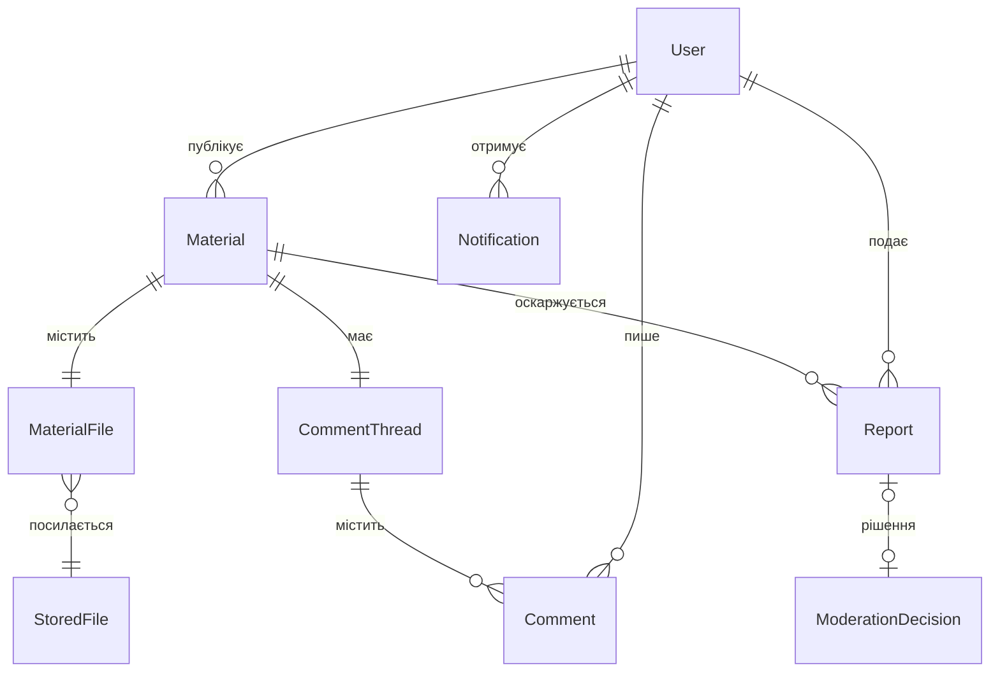

# Піддомени, сутності та атрибути

## 1. Піддомени

| # | Піддомен | Тип | Ключові сутності | Що робить |
|---|---|---|---|---|
| 1 | **Каталог матеріалів** | основний | Material, MaterialFile, MaterialType | Публікація, пошук і фільтрація матеріалів |
| 2 | **Користувачі та доступ** | загальний | User, Role, PasswordResetToken | Реєстрація, вхід, ролі, блокування (остаточне видалення акаунта) |
| 3 | **Обговорення** | допоміжний | CommentThread, Comment | Коментарі під матеріалами |
| 4 | **Модерація** | допоміжний | Report, ModerationDecision | Скарги та їх розгляд адміном |
| 5 | **Профілі** | допоміжний | UserProfile | Профіль користувача з його матеріалами |
| 6 | **Зберігання файлів** | загальний | StoredFile | Приймання й видача файлів |
| 7 | **Сповіщення** | загальний | Notification | Повідомлення про коментарі й результати скарг |
| 8 | **AI-помічник** | загальний | AssistantQuestion, AssistantAnswer | Відповіді на навчальні питання |

## 2. Сутності та атрибути

Типи: `int` — ціле число, `string` — текст, `bool` — так/ні, `date` — дата, `datetime` — дата й час, `enum` — значення з фіксованого списку, `T[]` — список.

### 2.1. Каталог матеріалів

**Material** — опублікований навчальний матеріал

| Атрибут | Тип | Опис |
|---|---|---|
| id | int | Ідентифікатор |
| title | string | Назва (1..200 символів) |
| description | string | Опис (до 1000 символів) |
| subject | string | Предмет |
| university | string | Університет |
| course | int | Курс (1..6) |
| type | MaterialType | Тип матеріалу |
| file | MaterialFile | Прикріплений файл |
| authorId | int | Автор (User.id) |
| authorNickname | string | Нікнейм автора |
| status | enum | `published` / `deleted` |
| createdAt | datetime | Дата публікації |

**MaterialFile** — файл матеріалу

| Атрибут | Тип | Опис |
|---|---|---|
| fileName | string | Назва файлу |
| format | enum | pdf, doc, docx, txt, ppt, pptx, zip, mp3, wav, mp4 |
| sizeBytes | int | Розмір у байтах |
| url | string | Посилання на файл у сховищі |

**MaterialType** — тип матеріалу

| Атрибут | Тип | Опис |
|---|---|---|
| code | enum | Конспект, лекція, практична, лабораторна, презентація, відео, аудіо, курсова, дипломна, магістерська |

### 2.2. Користувачі та доступ

**User** — зареєстрований користувач

| Атрибут | Тип | Опис |
|---|---|---|
| id | int | Ідентифікатор |
| nickname | string | Нікнейм (3..30, унікальний) |
| login | string | Логін (5..32, унікальний) |
| email | string | Електронна пошта |
| passwordHash | string | Хеш пароля (bcrypt) |
| birthDate | date | Дата народження |
| avatarUrl | string | Аватар |
| role | Role | Роль |

**Role** — роль користувача

| Атрибут | Тип | Опис |
|---|---|---|
| code | enum | `guest` (гість), `user` (користувач), `admin` (адмін) |

**PasswordResetToken** — токен скидання пароля

| Атрибут | Тип | Опис |
|---|---|---|
| tokenHash | string | Хеш токена |
| userId | int | Користувач (User.id) |
| createdAt | datetime | Коли створено |
| expiresAt | datetime | Діє не довше 5 хв |
| usedAt | datetime | Коли використано (одноразовий) |

### 2.3. Обговорення

**CommentThread** — коментарі під матеріалом

| Атрибут | Тип | Опис |
|---|---|---|
| materialId | int | Щоб знати, до якого матеріалу належать коментарі |
| materialAuthorId | int | Щоб надіслати автору сповіщення «Під вашим матеріалом новий коментар» |
| comments | Comment[] | Самі коментарі: хто написав, текст, дата |
| closed | bool | Якщо матеріал видалили, гілка закривається і нові коментарі додати не можна |

**Comment** — коментар

| Атрибут | Тип | Опис |
|---|---|---|
| id | int | Ідентифікатор |
| authorId | int | Автор (User.id) |
| authorNickname | string | Нікнейм автора |
| text | string | Текст (1..1000 символів) |
| createdAt | datetime | Дата створення |

### 2.4. Модерація

**Report** — скарга на матеріал

| Атрибут | Тип | Опис |
|---|---|---|
| id | int | Ідентифікатор |
| materialId | int | Матеріал (Material.id) |
| materialAuthorId | int | Автор матеріалу (User.id) |
| reporterId | int | Хто подав скаргу (User.id) |
| text | string | Текст скарги (1..1000 символів) |
| status | enum | `open` / `resolved` / `rejected` |
| decision | ModerationDecision | Рішення адміна |
| createdAt | datetime | Дата подання |

**ModerationDecision** — рішення адміна за скаргою

| Атрибут | Тип | Опис |
|---|---|---|
| deleteMaterial | bool | Видалити матеріал |
| blockAuthor | bool | Заблокувати автора: його акаунт остаточно видаляється |
| comment | string | Пояснення |

### 2.5. Профілі

**UserProfile** — профіль користувача. Власних даних не має: збирається з User і його матеріалів.

| Атрибут | Тип | Опис |
|---|---|---|
| nickname | string | Нікнейм |
| avatarUrl | string | Аватар |
| materials | Material[] | Власні опубліковані матеріали |

### 2.6. Зберігання файлів

**StoredFile** — збережений файл

| Атрибут | Тип | Опис |
|---|---|---|
| id | string | Ключ у сховищі |
| originalName | string | Оригінальна назва |
| mimeType | string | Тип файлу |
| sizeBytes | int | Розмір у байтах |
| uploadedBy | int | Хто завантажив (User.id) |
| uploadedAt | datetime | Коли завантажено |

### 2.7. Сповіщення

**Notification** — сповіщення користувачу

| Атрибут | Тип | Опис |
|---|---|---|
| id | int | Ідентифікатор |
| recipientId | int | Отримувач (User.id) |
| kind | enum | Вид сповіщення: new_comment — новий коментар під твоїм матеріалом; report_result — твою скаргу розглянули |
| message | string | Текст сповіщення |
| link | string | Посилання на матеріал або скаргу |
| createdAt | datetime | Дата створення |
| readAt | datetime | Коли прочитано |

### 2.8. AI-помічник

**AssistantQuestion** — питання до помічника

| Атрибут | Тип | Опис |
|---|---|---|
| userId | int | Хто запитує (User.id) |
| text | string | Текст питання (1..1000 символів) |

**AssistantAnswer** — відповідь помічника

| Атрибут | Тип | Опис |
|---|---|---|
| text | string | Текст відповіді |
| suggestedMaterialIds | int[] | Рекомендовані матеріали (Material.id) |

## 3. Зв'язки між сутностями

