# Практична 8. Observability: Grafana, Loki, Tempo, OpenTelemetry

Сервіс: **studyswap-api** (бекенд StudySwap, Express 5 + SQLite). Стенд — [observability-demo](https://github.com/vivalafit/observability-demo).

## Хто що робив

| Хто | Роль | Що зроблено |
|---|---|---|
| Юлія ([JuliaVushyvana](https://github.com/JuliaVushyvana)) | Розробник 1, код | OpenTelemetry у `studyswap-api`: трейси, метрики, логи, атрибути спанів, fault-перемикачі, `scripts/load.sh`, конфіги колектора й Prometheus (розділ 90, код) |
| Аніта ([lyutyanytsyaa](https://github.com/lyutyanytsyaa)) | Розробник 2, Grafana | стенд і скріни RED / Tempo / Loki (60); дашборд **My Demo RED** зі змінною `$service`, PromQL і LogQL (75); дашборд і логи на `studyswap-api`, TraceQL і p95 за роутами (90, частина Grafana); contact point, notification policy, 2 алерти, Alert list, runbook (95–100) |

Файли Розробника 2: `docs/my-demo-red-dashboard.json` (дашборд), `docs/alerts.yaml` (алерти, provisioning), `observability/alert-webhook.js` (приймач webhook), скріни в `docs/practice8/`.

## 60. Стенд і три сигнали

Стенд [observability-demo](https://github.com/vivalafit/observability-demo) піднято `docker compose up -d --build`: Grafana `:3001`, Prometheus `:9090`, Loki `:3100`, Tempo `:3200`, колектор OTLP `:4318`, `demo-app` + `loadgen`, що генерує трафік.

| Скрін | Що на ньому |
|---|---|
| 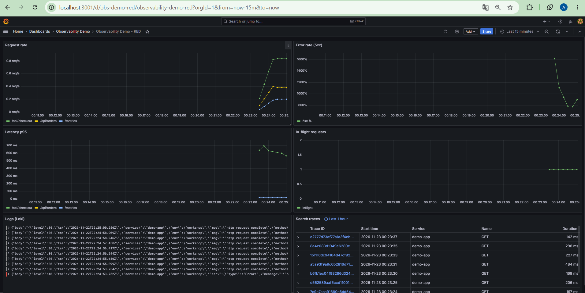 | Дашборд стенду **Observability Demo – RED**: Rate (запити/с за роутами), Errors (% 5xx), Duration (p95) для `demo-app`. Видно сплески помилок і затримок, які навмисно робить `loadgen` |
| 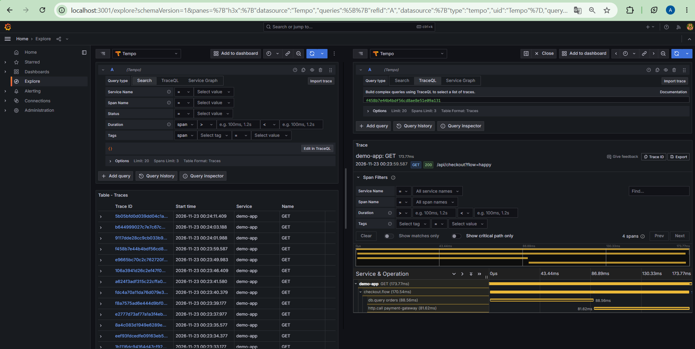 | **Tempo**: трейс одного запиту `demo-app` — дерево спанів (HTTP-запит → внутрішні кроки), тривалість кожного кроку, атрибути спану |
| 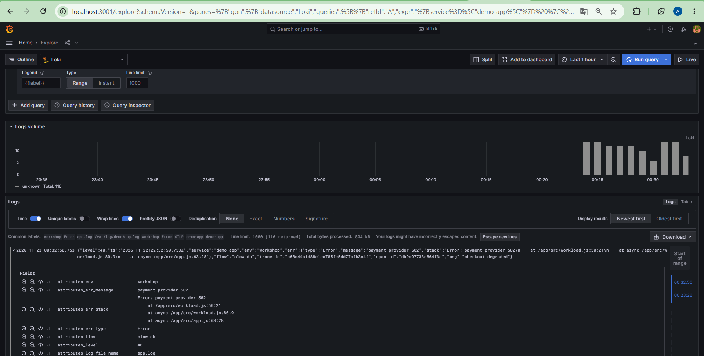 | **Loki** (Explore): `{service="demo-app"} \| json \| line_format "{{.body}}" \| json \| level >= 40` — лише попередження й помилки (pino: 40 = warn, 50 = error); у рядку є `trace_id`, з якого можна перейти в трейс |

Три сигнали разом: **метрики** показують, *що* погано (зросли помилки чи затримка), **трейси** — *де саме* (який крок запиту), **логи** — *чому* (текст помилки, стек).

## 75. Дашборд My Demo RED

Файл: `docs/my-demo-red-dashboard.json` (імпорт: Dashboards → New → Import → Upload JSON).

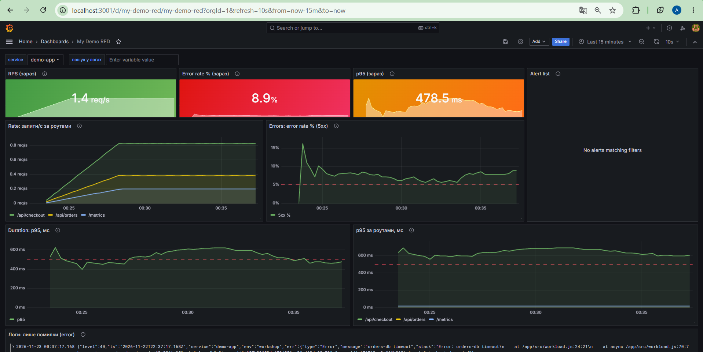

На `demo-app` видно: ~1.4 req/s, error rate ~9 % і p95 ~480–600 мс — обидва показники вище порогів майбутніх алертів (5 % і 500 мс), найповільніший роут — `/api/checkout`.

**Змінні:**
- `$service` (custom: `demo-app`, `studyswap-api`) — один дашборд для стенду і для нашого сервісу;
- `$search` (textbox) — текст для фільтра логів, порожньо — усі помилки.

Метрики в двох сервісів різні: `demo-app` пише їх через `prom-client` (`http_requests_total`, гістограма в **мс**, лейбл `service`), `studyswap-api` — через OpenTelemetry (`http_server_request_duration_seconds_*`, гістограма в **секундах**, лейбл `service_name`). Тому кожен запит має дві гілки, з'єднані `or`: для вибраного сервісу дані повертає лише одна з них.

| Панель | Тип | Запит |
|---|---|---|
| RPS (зараз), Rate: запити/с за роутами | stat, timeseries | PromQL 1 |
| Error rate % (зараз), Errors: error rate % | stat, timeseries (пунктир — поріг 5 %) | PromQL 2 |
| p95 (зараз), Duration: p95, мс | stat, timeseries (пунктир — поріг 500 мс) | PromQL 3 |
| p95 за роутами, мс | timeseries | PromQL 4 |
| Логи: лише помилки | logs | LogQL A, B |
| Alert list | alertlist | стан правил з `docs/alerts.yaml` |

**PromQL.** Вікно `[5m]` — згладжує шум і збігається з вікном алертів.

```promql
# 1. Rate — запитів/с за роутом: rate() перетворює лічильник на швидкість, sum by — групує
sum by (route) (rate(http_requests_total{service="$service"}[5m]))
or
sum by (http_route) (rate(http_server_request_duration_seconds_count{service_name="$service"}[5m]))

# 2. Errors — % відповідей 5xx; `or vector(0)` дає 0 %, коли помилок немає (інакше панель «No data»)
100 * (sum(rate(http_requests_error_total{service="$service"}[5m])) or vector(0))
  / sum(rate(http_requests_total{service="$service"}[5m]))
or
100 * (sum(rate(http_server_request_duration_seconds_count{service_name="$service", http_response_status_code=~"5.."}[5m])) or vector(0))
  / sum(rate(http_server_request_duration_seconds_count{service_name="$service"}[5m]))

# 3. Duration — p95 з бакетів гістограми; для OTel ×1000, бо метрика в секундах
histogram_quantile(0.95, sum by (le) (rate(http_request_duration_ms_bucket{service="$service"}[5m])))
or
1000 * histogram_quantile(0.95, sum by (le) (rate(http_server_request_duration_seconds_bucket{service_name="$service"}[5m])))

# 4. p95 за роутами — те саме, але з route / http_route у by
histogram_quantile(0.95, sum by (le, route) (rate(http_request_duration_ms_bucket{service="$service"}[5m])))
or
1000 * histogram_quantile(0.95, sum by (le, http_route) (rate(http_server_request_duration_seconds_bucket{service_name="$service"}[5m])))
```

**LogQL** (панель логів має два запити, дані дає той, що відповідає сервісу):

```logql
# A. demo-app: колектор кладе рядок pino в поле body ({"body":"{\"level\":40,...}"}),
#    тому: json → дістаємо body → line_format робить його рядком → ще раз json → фільтр за рівнем
#    (pino: 30 = info, 40 = warn, 50 = error; помилки demo-app з полем err пишуться з level 40)
{service="$service"} |= "$search" | json | line_format "{{.body}}" | json | level >= 40

# B. studyswap-api: OTLP-логи, рівень уже є лейблом
{service_name="$service", level="ERROR"} |= "$search"
```

`{…}` вибирає потік за лейблами (швидко, по індексу), `|= "текст"` — фільтр рядків, `| json` розбирає JSON у поля, `line_format` замінює рядок на вибране поле, `level >= 40` — фільтр за полем.

### Заготовки для 95–100 (на demo-app)

- **Contact point** `studyswap-webhook` (webhook → `http://host.docker.internal:9999/alert`, приймач — `observability/alert-webhook.js`).
- **Notification policy**: усі алерти → `studyswap-webhook`, групування за `alertname`, `group_wait` 30 с, повтор раз на годину.
- **2 чернетки алертів** на метриках `demo-app` (запити — у коментарі на початку `docs/alerts.yaml`): error rate > 5 % і p95 > 500 мс за 5 хв.
- **Alert list** — панель на дашборді.


## 90. Підключення OTEL

### Бібліотеки

| Пакет | Навіщо |
|---|---|
| `@opentelemetry/sdk-node` | NodeSDK: збирає трейси, метрики й логи в один запуск |
| `@opentelemetry/auto-instrumentations-node` | автоінструментація `http` і `express`: HTTP-спани, `http.route`, метрики `http.server.request.duration` |
| `@opentelemetry/exporter-trace-otlp-http` | трейси → `POST /v1/traces` колектора |
| `@opentelemetry/exporter-metrics-otlp-http` + `@opentelemetry/sdk-metrics` | метрики → `/v1/metrics`, раз на 10 с (`PeriodicExportingMetricReader`) |
| `@opentelemetry/exporter-logs-otlp-http` + `@opentelemetry/sdk-logs` | логи → `/v1/logs` (`BatchLogRecordProcessor`) |
| `@opentelemetry/api`, `@opentelemetry/core` | API для атрибутів і логів у коді; `getRPCMetadata` — доступ до серверного спану запиту |

SDK 3.x: читачі метрик передаються як `metricReaders: [...]`, процесор логів — як `new BatchLogRecordProcessor({ exporter })`. Старий стиль із прикладів (`metricReader`, `new BatchLogRecordProcessor(exporter)`) не дає помилки, але метрики тоді йдуть раз на 60 с, а логи не йдуть зовсім.

### Як підключено

- `backend/tracing.js` стартує SDK **до** застосунку: `npm run start:otel` = `node --env-file-if-exists=.env -r ./tracing.js server.js`. Звичайний `npm start` і тести працюють без телеметрії (API OpenTelemetry тоді no-op).
- Автоінструментація: `http` (без `/health` і без власних запитів експортерів до `:4318`), `express` (лише router і request handler, без спану на кожен middleware). `fs`, `dns`, `net`, `router` вимкнені: дрібні спани або дублікати шарів Express 5.
- Логи — `backend/logger.js`: JSON-рядок на подію в `backend/data/logs/app.log` (з полями `trace_id`, `span_id`, `request_id`) і той самий запис по OTLP Logs у Loki. Access-лог пише `api/middleware/telemetry.js` після кожної відповіді; рівень — `info` / `warn` (4xx) / `error` (5xx).

Приклад рядка `app.log`:

```json
{"ts":"2026-11-22T20:07:19.647Z","level":"info","service":"studyswap-api","msg":"POST /auth/login 200","request_id":"ca6c5291-…","method":"POST","route":"/auth/login","path":"/auth/login","status":200,"duration_ms":79.6,"app_context":"identity","user_id":2,"trace_id":"4b964c7dc9fffafeb16af666bc42c589","span_id":"e7707333fef92fb6"}
```

### Змінні оточення (`backend/.env.example`)

| Змінна | Значення | Що робить |
|---|---|---|
| `OTEL_SERVICE_NAME` | `studyswap-api` | `service.name` у Tempo, лейбл `service_name` у Prometheus і Loki |
| `OTEL_EXPORTER_OTLP_ENDPOINT` | `http://localhost:4318` | OTLP HTTP колектора; шляхи `/v1/traces`, `/v1/metrics`, `/v1/logs` додаються самі |
| `OTEL_METRIC_EXPORT_INTERVAL` | `10000` (за замовч.) | як часто відправляти метрики, мс |
| `LOG_FILE` | `backend/data/logs/app.log` (за замовч.) | файл JSON-логів |
| `FAULT_ERROR_RATE` | `0` (вимкнено) | частка запитів 0..1, що завершуються 500 |
| `FAULT_DELAY_MS` | `0` (вимкнено) | затримка кожного запиту, мс |
| `RATE_LIMIT_MAX` | `100000` для навантаження | інакше `scripts/load.sh` упирається в 429 (50 запитів / 10 с) |

### Атрибути спанів

Усі атрибути пишуться на серверний HTTP-спан (`GET /materials/:id` тощо).

| Атрибут | Звідки | Приклад |
|---|---|---|
| `http.route` | інструментація Express (шаблон роуту, не конкретний URL) | `/materials/:id` |
| `user.id` | `req.user` (currentUser) у `api/middleware/auth.js`; для `POST /auth/login` — з результату входу | `2` |
| `material.id` | `router.param('id')` у `materialsRouter`; для `POST /materials` — id створеного матеріалу | `5` |
| `app.context` | bounded context роуту: `/materials` → `catalog`, `/auth` і `/users` → `identity`, `/files` → `storage` | `catalog` |
| `request.id` | `X-Request-Id` (той самий, що в `ErrorResponse.requestId`) | `ca6c5291-…` |

Для 500 додатково записується подія `exception` зі стеком. Ті самі поля (`user_id`, `material_id`, `app_context`, `request_id`) є в access-логу.

### Як користуватися атрибутами в Grafana

1. **Tempo → Search (TraceQL)**: усі повільні запити до каталогу конкретного матеріалу:
   `{resource.service.name="studyswap-api" && span.app.context="catalog" && span.material.id="5" && duration > 300ms}`.
   Скарга користувача «у мене не відкривається» → `{resource.service.name="studyswap-api" && span.user.id=2 && status=error}`.
2. **Loki → трейс**: `{service_name="studyswap-api", level="ERROR"} | json` показує збої з `traceid`; по ньому відкривається трейс у Tempo. Пошук за запитом із повідомлення про помилку — `{service_name="studyswap-api"} |= "<requestId>"`.

### Скріни

- [ ] Tempo: трейс `studyswap-api` з атрибутами серверного спану — `docs/practice8/tempo-trace.png`

## 90. Частина Grafana (Розробник 2)

Після того як пішли дані від `studyswap-api`: `docker compose stop loadgen app`, API з телеметрією (`npm run start:otel`) і `scripts/load.sh`.

- На дашборді **My Demo RED** вибрано `$service = studyswap-api`. Назви метрик правити не довелося: OTel-гілка запитів уже написана під `http_server_request_duration_seconds_*` і `service_name` (з «Передачі Розробнику 2» нижче).

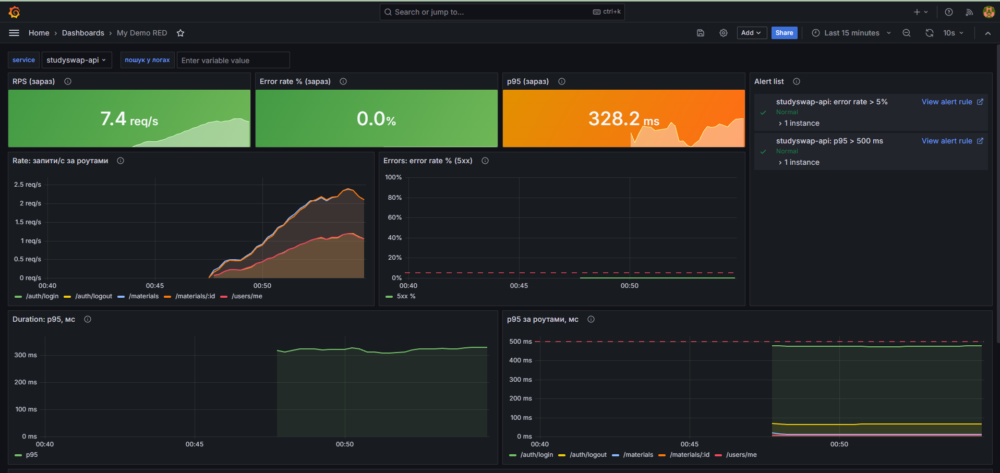

Під `load.sh` без збоїв: ~7.4 req/s, error rate 0 %, p95 ~330 мс. Панель «p95 за роутами» показує, що p95 тягне вгору `/auth/login` (~330 мс): вхід перевіряє пароль через bcrypt, який навмисно повільний (захист від підбору). Решта роутів — одиниці мілісекунд.
- Логи в Loki: `{service_name="studyswap-api"} | json` розбирає рядок на поля `attributes_app_context`, `attributes_material_id`, `attributes_route`, `attributes_status`, `attributes_duration_ms`, `traceid`. Фільтр помилок `{service_name="studyswap-api", level="ERROR"}` перевірено під час fault-тесту (95–100): показує лише 500 з `FAULT_INJECTED`.

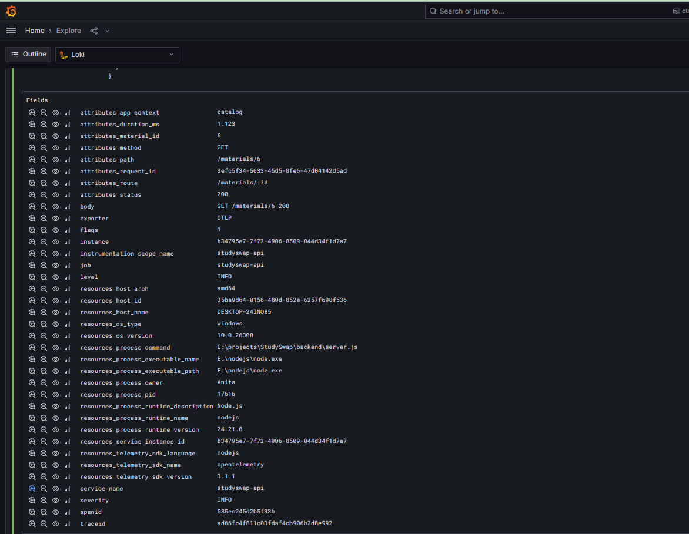

**Приклад 1. TraceQL за `material.id`** (Explore → Tempo → TraceQL):

```traceql
{ resource.service.name = "studyswap-api" && span.material.id = "4" }
{ resource.service.name = "studyswap-api" && span.http.route = "/materials/:id" } | select(span.material.id, span.app.context)
```

Навіщо: користувач скаржиться «матеріал №4 не відкривається» — знаходимо саме його запити і бачимо в дереві спанів, де пішов час. `select(...)` додає в таблицю результатів колонки `material.id` і `app.context`, щоб одразу бачити, які матеріали є в трейсах. `material.id` — рядок (`"4"`, а для неіснуючих — `"missing-…"`), тому значення в лапках.

Знайдений трейс: серверний спан `GET /materials/:id` (Kind: server) з атрибутами `material.id = "4"`, `app.context = "catalog"`, `http.route = "/materials/:id"`, `url.path = "/materials/4"`, `request.id`, під ним — `router` і `request handler`.

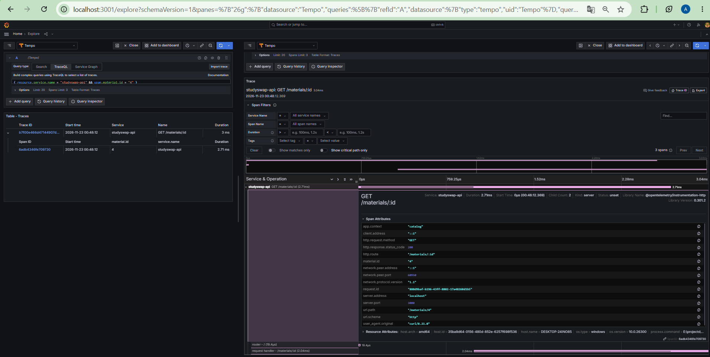

Примітка: колектор семплує трейси (`tail_sampling`: усі помилки, усі > 400 мс і 10 % решти), тому швидких успішних запитів у Tempo лише частина — для пошуку за конкретним `material.id` беремо той, що є в збережених трейсах.

**Приклад 2. p95 у розрізі `http.route` і `app.context`.**

```promql
# Prometheus: p95 за роутом, мс (панель «p95 за роутами» дашборду)
1000 * histogram_quantile(0.95, sum by (le, http_route) (rate(http_server_request_duration_seconds_bucket{service_name="studyswap-api"}[5m])))
```

```logql
# Loki: p95 за bounded context з access-логу (поле duration_ms), мс
quantile_over_time(0.95, {service_name="studyswap-api"} | json | unwrap attributes_duration_ms [5m]) by (attributes_app_context)
```

`app.context` у метриках не лейбл (лише в спанах і логах), тому p95 за контекстом рахуємо з логів: `unwrap` бере числове поле `duration_ms`, `quantile_over_time` — перцентиль за 5 хв, `by` — окремо для кожного контексту.

Результат: `identity` ~440 мс (вхід із bcrypt), `catalog` — кілька мілісекунд. Лінії `storage` немає, бо `load.sh` не звертається до `/files`. Висновок: загальний p95 високий через вхід, а не через каталог — без розбивки за контекстом цього не видно.

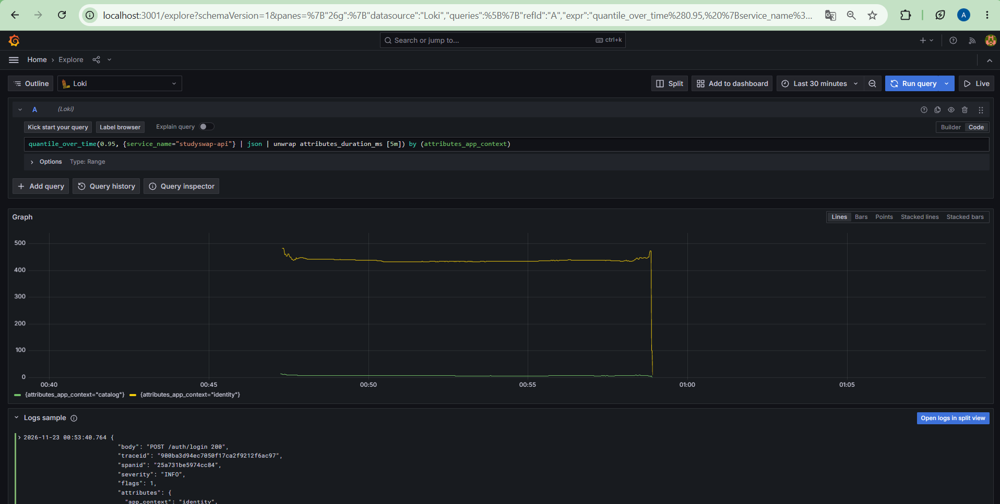

## 95–100. Алерти

Файл `docs/alerts.yaml` — provisioning Grafana: contact point, notification policy і група `studyswap-red` з двома правилами (папка **StudySwap**). Чернетки правил — ті самі умови на метриках `demo-app` (запити в коментарі на початку файлу); фінальна версія дивиться на `studyswap-api`.

| Правило | Запит (A) | Умова | `for` | Severity |
|---|---|---|---|---|
| `studyswap-api: error rate > 5%` | % 5xx за 5 хв (PromQL 2 для `studyswap-api`) | `B = last(A)`, `C = B > 5` | 5m | critical |
| `studyswap-api: p95 > 500 ms` | p95 за 5 хв, мс (PromQL 3) | `B = last(A)`, `C = B > 500` | 5m | warning |

`for: 5m` — умова має триматися 5 хв: стан іде Normal → **Pending** → **Firing**. Без трафіку правило `OK` (`noDataState: OK`), а не тривога.

**Як доведено до Firing:** у `backend/.env` вмикаємо fault-перемикач, перезапускаємо API і `load.sh` на 10 хв (`DURATION=600`):

| Алерт | Перемикач | Що бачимо |
|---|---|---|
| error rate | `FAULT_ERROR_RATE=0.2` | ~20 % відповідей 500 `FAULT_INJECTED` → Error rate ≈ 20 % > 5 % |
| p95 | `FAULT_DELAY_MS=800` | кожен запит +800 мс → p95 ≈ 800+ мс > 500 мс |

Скріни:

Хід (23.11, ~01:12–01:18): збої ввімкнено → за 1 хв обидва правила **Pending** → через 5 хв (`for: 5m`) **Firing** → webhook отримав сповіщення.

**Умова.** Сторінка правила error rate: A = 20.37 % (збігається з `FAULT_ERROR_RATE=0.2`), B = Last → 20.37, C = `B is above 5` → Firing. Видно мітки `severity=critical`, опис і Runbook URL.

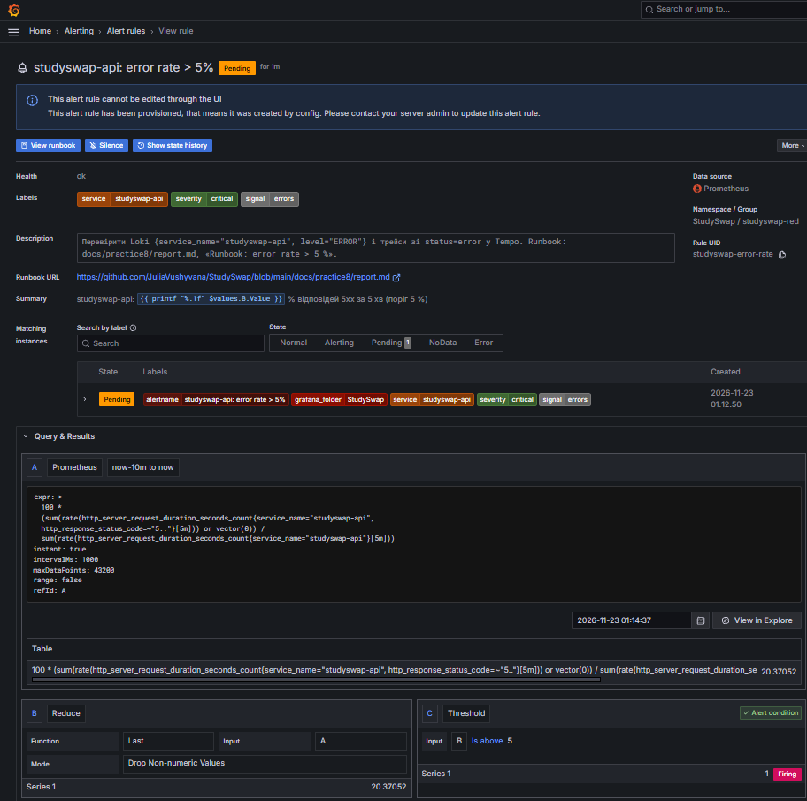

**Alerting.** Обидва правила у стані Firing.

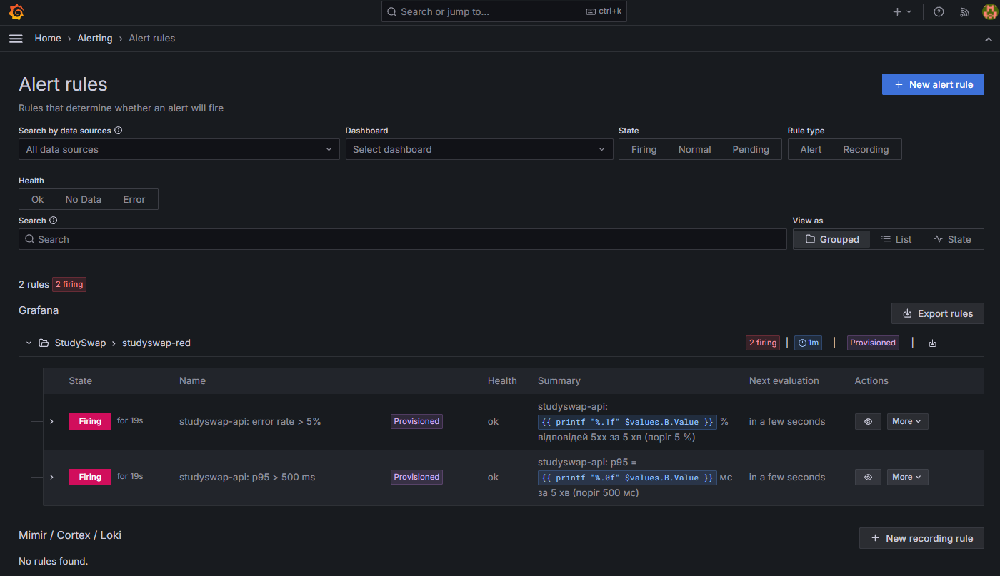

**Дашборд.** Alert list — обидва Firing; Error rate 20.3 %, p95 996 мс, обидва вище пунктирних порогів; логи помилок з `severity: ERROR`.

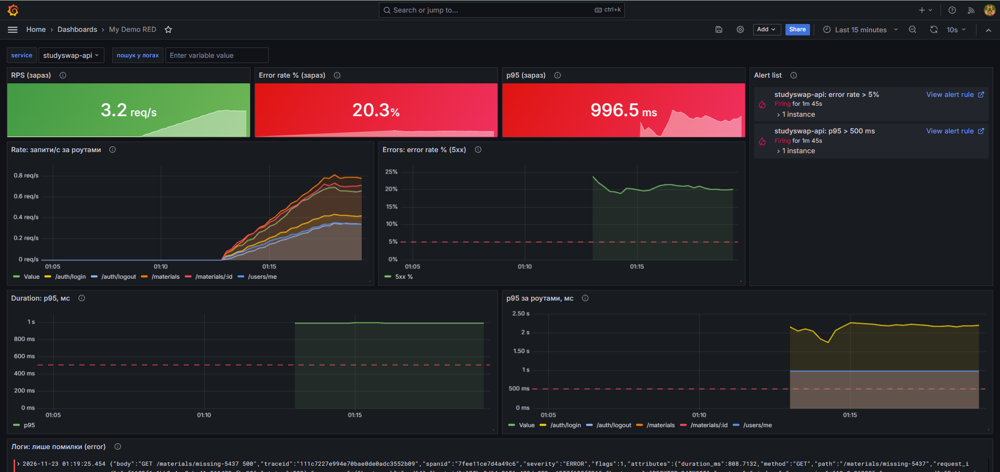

Лінія **«Value»** у легенді «Rate» і «p95 за роутами» — запити, що впали на fault-перемикачі **до** маршрутизації: у них порожній `http_route`. Тому error rate рахуємо за `service_name`, а не за роутом.

**Webhook.** `alert-webhook.js` отримав два сповіщення (політика групує за `alertname`), шаблон summary вже з реальними числами: 21.2 % 5xx і p95 = 995 мс.

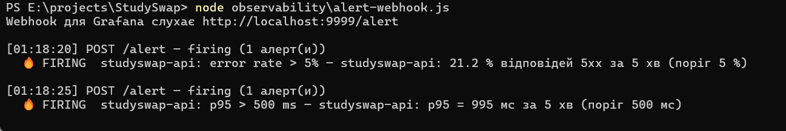

Після скрінів перемикачі повернуто в `0`.

### Runbook: error rate > 5 %

1. **Підтвердити.** Дашборд My Demo RED (`$service = studyswap-api`): панель Errors — це сплеск чи стабільно високо? Чи зріс RPS (навантаження)?
2. **Знайти причину в логах.** Loki: `{service_name="studyswap-api", level="ERROR"}`. Подивитися `code` і `route`:
   - `FAULT_INJECTED` — увімкнено fault-перемикач: `FAULT_ERROR_RATE=0` у `backend/.env`, перезапустити API;
   - `CATALOG_UNAVAILABLE` / помилки SQLite — база недоступна: перевірити файл БД і місце на диску, `GET /health`;
   - інше — відкрити трейс за `traceid` у Tempo, знайти спан з `status=error` і подією `exception` (стек).
3. **Звузити.** Tempo: `{resource.service.name="studyswap-api" && status=error}` — який `http.route`, `app.context`, чи це один користувач (`span.user.id`).
4. **Виправити / відкотити.** Якщо почалося після деплою — відкотити на попередній образ `ghcr.io/…/studyswap-api` (CD), далі виправлення через PR.
5. **Закрити.** Дочекатися, поки алерт перейде в Normal (webhook надішле RESOLVED), коротко записати причину.

### Runbook: p95 > 500 мс

1. **Підтвердити.** Панель Duration: p95 і «p95 за роутами» — повільно все чи один роут?
2. **Знайти повільні запити.** Tempo: `{resource.service.name="studyswap-api" && duration > 500ms}` — у дереві спанів видно, де пішов час (обробник, SQLite, файл).
3. **Типові причини:**
   - `FAULT_DELAY_MS` > 0 — вимкнути (`FAULT_DELAY_MS=0`), перезапустити API;
   - сплеск навантаження (RPS на дашборді) — частина запитів може впиратися в rate limit / таймаут 5 с (`REQUEST_TIMEOUT_MS`);
   - повільний пошук `GET /materials` з фільтрами — перевірити запит у трейсі, індекси в БД;
   - великі файли `GET /files/:id` — нормальна тривалість для великого файлу, тоді роут виключити з алерту або підняти поріг для нього.
4. **Перевірити, що не зачепило помилки.** Error rate не зріс? Якщо зріс — runbook error rate.
5. **Закрити.** p95 нижче 500 мс 5 хв → алерт Normal, записати причину.


## Як запустити

```bash
# 1. Стенд (окремий репозиторій). Конфіги колектора й Prometheus — з цього репо:
#    у демо колектор не приймає OTLP-метрики (немає metrics-пайплайну) і бере логи лише з файлів.
cp observability/otel-collector-config.yaml observability/prometheus.yml ../observability-demo/
cd ../observability-demo && docker compose up -d --build
docker compose stop loadgen app          # demo-app займає порт 3000 і шумить у даних

# 2. API з телеметрією
cd ../StudySwap/backend && cp .env.example .env && npm install && npm run start:otel
#    збої для алертів: FAULT_ERROR_RATE=0.2 npm run start:otel  або  FAULT_DELAY_MS=800 npm run start:otel

# 3. Навантаження
../scripts/load.sh                       # WORKERS=4 DURATION=60 BASE_URL=http://localhost:3000
```

Зміни в `observability/otel-collector-config.yaml` (позначені коментарем `studyswap-api`): пайплайн `metrics` (OTLP → експортер `prometheus` на `collector:8889` з лейблом `service_name`), приймач `otlp` у пайплайні `logs`, лейбли Loki `service_name` і `level`. У `prometheus.yml` — job `studyswap-api` (`collector:8889`, `honor_labels: true`).

## Передача Розробнику 2

**Гілка:** `feat/otel`. **Запуск:** див. «Як запустити» вище.

### Метрики в Prometheus (звірено через `/api/v1/series`)

| Метрика | Тип | Що це |
|---|---|---|
| `http_server_request_duration_seconds_bucket` / `_count` / `_sum` | histogram, **секунди** | тривалість вхідних HTTP-запитів; `_count` — кількість запитів |
| `nodejs_eventloop_delay_p99_seconds`, `nodejs_eventloop_utilization_ratio` | gauge | затримка й завантаження event loop |
| `v8js_memory_heap_used_bytes`, `v8js_gc_duration_seconds_*` | gauge / histogram | пам'ять і GC |

Лейбли `http_server_request_duration_seconds_*`: `service_name="studyswap-api"`, `job="studyswap-api"`, `instance` (новий після кожного перезапуску), `http_route`, `http_request_method`, `http_response_status_code`, `error_type` (лише для 5xx), `url_scheme`, `network_protocol_version`, `le` (bucket).

`http_route` порожній, якщо запит не дійшов до роуту: 404 невідомого шляху, 429 і штучні 500 з `FAULT_ERROR_RATE` (збій стається до маршрутизації). Тому в error rate фільтруйте лише за `service_name`, а не за `http_route`.

Перевірені запити (під навантаженням `load.sh` з `FAULT_ERROR_RATE=0.1`: ~26 RPS, 9.5 % 5xx, p95 66 мс):

```promql
# Rate, запитів/с за роутами
sum by (http_route) (rate(http_server_request_duration_seconds_count{service_name="studyswap-api"}[5m]))

# Errors, % 5xx
100 * sum(rate(http_server_request_duration_seconds_count{service_name="studyswap-api", http_response_status_code=~"5.."}[5m]))
    / sum(rate(http_server_request_duration_seconds_count{service_name="studyswap-api"}[5m]))

# Duration, p95 у мс (метрика в секундах)
1000 * histogram_quantile(0.95, sum by (le) (rate(http_server_request_duration_seconds_bucket{service_name="studyswap-api"}[5m])))
```

### Логи в Loki

Лейбли: `service_name="studyswap-api"`, `job="studyswap-api"`, `level` (`INFO` / `WARN` / `ERROR`), `exporter="OTLP"`, `instance`. Рядок — JSON з полями `body`, `traceid`, `spanid`, `severity`, `attributes` (`request_id`, `route`, `status`, `duration_ms`, `user_id`, `material_id`, `app_context`).

```logql
{service_name="studyswap-api", level="ERROR"}
{service_name="studyswap-api"} | json | attributes_status >= 500
```

### Трейси в Tempo

`service.name = studyswap-api`; атрибути серверного спану — у таблиці вище. Стенд семплує трейси в колекторі (`tail_sampling`): усі помилкові, усі довші за 400 мс і 10 % решти — тож не кожен запит з `load.sh` буде в Tempo.

### Fault-перемикачі

`api/middleware/faultInjection.js`, підключається лише коли хоч один перемикач > 0; `/health` не зачіпає.

| Змінна | Діапазон | Ефект | Для якого алерту |
|---|---|---|---|
| `FAULT_ERROR_RATE` | `0..1`, за замовч. `0` | така частка запитів повертає `500 InternalError` з `code: FAULT_INJECTED` | error rate (> 1–5 % за 5 хв) |
| `FAULT_DELAY_MS` | мс, за замовч. `0` | кожен запит чекає стільки перед обробкою | p95 latency (> 500 мс) |

Задаються в `backend/.env` або перед командою: `FAULT_ERROR_RATE=0.2 FAULT_DELAY_MS=600 npm run start:otel`. Старий `CHAOS=1` (Практика 5: випадкові 503/500 і затримки для перевірки фронтенду) лишився без змін.
