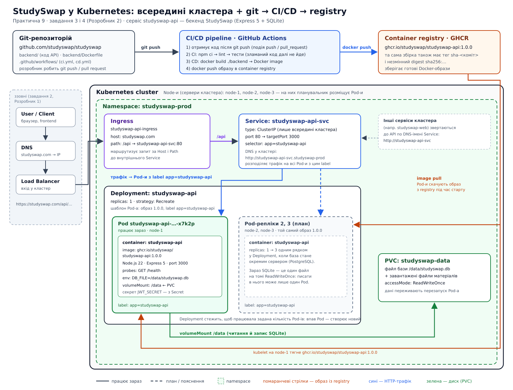

# Практична 9. Kubernetes-схема studyswap-api: завдання 3–5 (Розробник 2)

Джерело схеми: [`k8s-cluster-cicd.svg`](k8s-cluster-cicd.svg).

## Завдання 3. Всередині кластера

| Елемент | Значення |
|---|---|
| Namespace | `studyswap-prod` |
| Ingress | `studyswap-api-ingress`: host `studyswap.com`, path `/api` → `studyswap-api-svc:80` |
| Service | `studyswap-api-svc`, тип **ClusterIP**, порт 80 → targetPort 3000, selector `app=studyswap-api` |
| Deployment | `studyswap-api`, **replicas: 1**, strategy `Recreate`, образ `ghcr.io/studyswap/studyswap-api:1.0.0` |
| Pod | контейнер `studyswap-api` (Node.js 22, Express 5, порт 3000), probes `GET /health`, `DB_FILE=/data/studyswap.db` |
| Сховище | PVC `studyswap-data` (ReadWriteOnce), змонтований у `/data`, файл `/data/studyswap.db` |

Шлях усередині кластера: **Ingress → Service → Pod-и** з label `app=studyswap-api`. Інші сервіси кластера звертаються до API за DNS-іменем `http://studyswap-api-svc`.

На схемі показано 1 Pod, що працює зараз, і пунктиром Pod-репліки 2–3 як план. SQLite — це один файл на томі ReadWriteOnce, і писати в нього може лише один Pod. Тому `replicas: 1` і `strategy: Recreate`: старий Pod зупиняється до старту нового, щоб два Pod-и не писали в один файл. Після переходу на PostgreSQL достатньо змінити `replicas: 1 → 3`.

## Завдання 4. git → CI/CD → registry

- **Git:** `github.com/studyswap/studyswap` (код `backend/`, `backend/Dockerfile`, `.github/workflows/`).
- **CI/CD (GitHub Actions):** отримує код після `git push`, проганяє CI (`npm ci` → lint → тести), збирає Docker image з `./backend` і пушить його в registry.
- **Registry (GHCR):** `ghcr.io/studyswap/studyswap-api:1.0.0` (та сама збірка також має тег `sha-<коміт>` і digest).
- **Стрілки:** git → CI/CD → registry (збірка й пуш образу); registry → Pod-и (kubelet на node скачує образ під час старту Pod-а).

## Завдання 5. Опис дизайну

Ми моделюємо `studyswap-api` — бекенд StudySwap (Express 5 + SQLite), який живе в namespace `studyswap-prod` кластера Kubernetes. Запит користувача на `https://studyswap.com/api/…` через DNS потрапляє на Load Balancer, Ingress за host `studyswap.com` і path `/api` передає його на Service `studyswap-api-svc` типу ClusterIP (порт 80 → 3000), а Service розподіляє трафік на Pod-и Deployment-а `studyswap-api` з label `app=studyswap-api`. Ми заклали 1 Pod, бо SQLite — це один файл на PVC `studyswap-data`, у який може писати лише один Pod (після переходу на PostgreSQL збільшимо до 2–3 реплік для відмовостійкості); код зберігається в git (`github.com/studyswap/studyswap`), після `git push` GitHub Actions проганяє тести, збирає Docker-образ і пушить його в `ghcr.io/studyswap/studyswap-api:1.0.0`, звідки Pod-и скачують образ під час старту.
