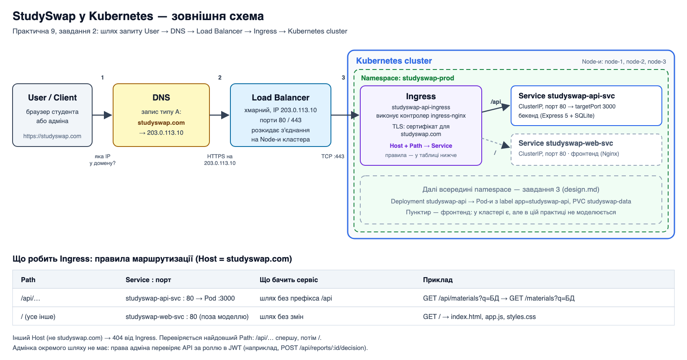

# Практична 9. Теоретична схема Kubernetes-додатку: завдання 1–2 (Розробник 1)

Завдання 3–5 (всередині кластера, git → CI/CD → registry, опис дизайну) — у [design.md](design.md).

## 1. Сервіс

**StudySwap** — веб-платформа для обміну навчальними матеріалами між студентами: конспектами, лекціями, шпаргалками з пошуком за предметом і курсом. Користувачі — студенти (завантажують, шукають і коментують матеріали, скаржаться на порушення) та адміністратори (розглядають скарги й модерують контент). У Kubernetes моделюємо сервіс **`studyswap-api`** — бекенд StudySwap (Express 5 + SQLite), через який проходять усі дані; фронтенд `studyswap-web` (Nginx, статичні файли) лише показуємо на схемі як сусіда.

## 2. Зовнішня схема: від користувача до кластера

Джерело схеми — [external-scheme.svg](external-scheme.svg) (редагується в будь-якому SVG-редакторі; PNG рендериться з нього).

**Домен:** `studyswap.com` — один хост і для фронтенду, і для API.

**Шлях запиту:**

1. **User → DNS.** Браузер відкриває `https://studyswap.com` і питає DNS, яка IP в домену. A-запис повертає `203.0.113.10` — зовнішню IP балансувальника.
2. **DNS → Load Balancer.** Браузер підключається на `203.0.113.10:443`. Хмарний Load Balancer приймає з'єднання на портах 80/443 і розкидає їх на Node-и кластера.
3. **Load Balancer → Ingress.** На Node-ах з'єднання приймає контролер `ingress-nginx`. Він завершує TLS (сертифікат для `studyswap.com`) і застосовує правила Ingress `studyswap-api-ingress` з namespace `studyswap-prod`.
4. **Ingress → Service.** Ingress зіставляє Host і Path із правилами та передає запит у внутрішній Service типу ClusterIP. Далі Service розкидає трафік на Pod-и (завдання 3).

**Правила Ingress** (Host = `studyswap.com`):

| Path | Service : порт | Що бачить сервіс | Приклад |
|---|---|---|---|
| `/api/…` | `studyswap-api-svc : 80` → Pod `:3000` | шлях без префікса `/api` | `GET /api/materials?q=БД` → `GET /materials?q=БД` |
| `/` (усе інше) | `studyswap-web-svc : 80` (поза моделлю) | шлях без змін | `GET /` → `index.html`, `app.js`, `styles.css` |

- Спершу перевіряється довший Path (`/api/…`), решта йде на фронтенд. Запит з іншим Host отримує 404 від Ingress.
- Префікс `/api` Ingress відрізає (rewrite), тому маршрути бекенду (`/materials`, `/auth/login`, `/reports`) не змінюються.
- Фронтенд і API на одному домені, тож браузер не робить cross-origin запитів і CORS не потрібен. Для цього `API_URL` у `frontend/app.js` треба буде змінити з `http://localhost:3000` на `/api`.
- Окремого шляху `/admin` немає: права адміна й головного адміністратора перевіряє API за роллю в JWT (наприклад, `POST /api/reports/:id/decision`).

**Схема коротко:** браузер питає DNS і отримує IP балансувальника → балансувальник передає запит в Ingress → Ingress за шляхом відправляє `/api` на бекенд, а решту на фронтенд → Service розподіляє запити між Pod-ами.

- **Load Balancer** — хмарний балансувальник: приймає HTTPS на `203.0.113.10` і розкидає з'єднання між Node-ами (node-1, node-2, node-3), щоб жоден не був перевантажений.
- **Ingress** — розшифровує HTTPS за сертифікатом `studyswap.com` і за доменом та шляхом вирішує, який сервіс має відповісти.
- **Service (ClusterIP)** — доступний лише всередині кластера, розподіляє запити між Pod-ами бекенду на порт 3000.
- **Namespace `studyswap-prod`** (зелена рамка) — окремий простір кластера для продакшн-версії StudySwap.
- **Пунктир** — фронтенд `studyswap-web`: у кластері він є, але в цій практиці не моделюється.

**Питання до схеми:**

- *Навіщо Ingress, якщо є Load Balancer?* Load Balancer просто розкидає трафік. Ingress розбирається в адресах і за доменом та шляхом вирішує, який сервіс має відповісти.
- *Чому CORS не потрібен?* Фронтенд і API на одному домені, тому браузер не робить запитів на інший домен.
- *Де адмінка?* Окремого шляху `/admin` немає: права адміна перевіряє API за роллю в JWT-токені.
- *Що буде із запитом на інший домен?* Ingress поверне 404.
- *Навіщо відрізати префікс `/api`?* Щоб маршрути бекенду (`/materials`, `/auth/login`) лишилися такими самими, як при локальному запуску, і код не довелося міняти.
